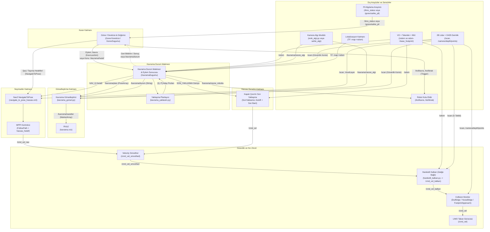

# Nav2 + Kavrama Mimarisi ve Ekip Kullanım Rehberi

Bu belge; AgileX LIMO mobil robotu ve üzerine entegre Elephant Robotics myCobot 280 robot kolu için geliştirilen otonom seyrüsefer (Nav2), yaklaşma planlaması, hız/güvenlik zinciri, RViz görselleştirmesi, görev yönetimi ve kapalı çevrim kavrama mimarisini ayrıntılandırmaktadır. Hedef okuyucu kitlesi; görsel odometri (VO) üzerinde çalışan ekip arkadaşımız, robot kolu manipülasyonu üzerinde çalışan ekip arkadaşımız ve sistemin bakımını/geliştirmesini sürdürecek araştırmacılardır.

---

## 1. Mimari Özet ve Tasarım Kararları

### 1.1. Tasarım Gerekçeleri ve Temel Mimari Karar
İlk denemelerde ve simülasyon testlerinde (bkz. [sim_gercek.md](file:///home/gunes/limo_robot/limo_ws/docs/sim_gercek.md)), kavrama öncesi konumlandırma için 2B Lidar ICP ve küresel AMCL lokalizasyonuna dayanılmıştı. Ancak bu yaklaşım şu kritik sorunları ortaya çıkardı:
1. **AMCL Yetersizliği:** AMCL küresel kestirimi simülasyonda dahi $5\text{--}11\text{ cm}$ ve $4^\circ$ mertebesinde kaymalar üretmektedir. Oysa robot kolunun nesneyi başarıyla yakalayabilmesi için kabul kriterimiz $|\Delta x| < 2\text{ cm}$, $|\Delta y| < 2\text{ cm}$ ve $|\text{yön hatası}| < 3^\circ$ sınırlarıdır.
2. **Lidar ICP Kırılganlığı:** Lidar ICP, simetrik ortamlarda (koridor, düz duvarlar) açısal veya boyuna kaymalara açıktır; ayrıca kavranacak nesne lidar görüşünde yer aldığında harita ile uyuşmazlık yaratarak ince düzeltmeyi bozabilmektedir.

**Alınan Kesin Mimari Karar:**
- **Lidar Odometrisi / ICP Kaldırıldı:** Lidar ICP ve lidar odometrisi mimariden tamamen çıkarılmıştır. Lidar (`/scan`), yalnızca maliyet haritaları (costmap), güvenlik konisi durdurması, dinamik engel takibi ve Nav2 global/local engel tespiti için kullanılır.
- **Odometri Kaynağı:** Taban odometrisi (`/odom`), Görsel Odometri (VO) + tekerlek enkoderi + IMU füzyonundan gelir (ekip arkadaşımızın sorumluluğundadır).
- **Küresel Lokalizasyon (`map -> odom`):** Harita ile odometri arasındaki dönüşüm küresel lokalizasyon katmanından gelir (simülasyonda AMCL bir yer tutucu/referanstır; gerçekte görsel SLAM / harita tabanlı lokalizasyon olacaktır).
- **Göreceli Kapalı Çevrim Son Yaklaşma:** Kavrama hassasiyeti, küresel harita koordinatlarından değil; nesnenin robot gövdesine göre doğrudan kamera/algı ile ölçüldüğü kapalı çevrim son yaklaşma denetleyicisinden ([`SonYaklasma`](file:///home/gunes/limo_robot/limo_ws/src/limo_autonomy/limo_autonomy/son_yaklasma.py#L184)) elde edilir. Böylece küresel haritadaki AMCL kayması veya odometrideki uzun vadeli sürüklenme kavrama başarısını etkilemez.

Koordinat dönüşüm zinciri şu şekilde bağlanır:
$$T_{\text{map}}^{\text{nesne}} \xrightarrow[\text{kaba}]{} Q(\theta) \xrightarrow[\text{Nav2}]{} \text{Robot}_Q \xrightarrow[\text{Kamera: } T_{\text{base}}^{\text{nesne}}]{} \text{Kapalı Çevrim } P(\theta) \xrightarrow[\text{hassas}]{} \text{Kavrama}$$

### 1.2. Katman ve Veri Akış Mimarisi

Sistem; en üstte görev karar katmanından başlayarak donanım motor sürücülerine ve RViz görselleştiricisine kadar hiyerarşik bir yapıda çalışır:



### 1.3. Hız Zinciri ve Güvenlik (Velocity Smoother, Hareketli Kalkan ve Collision Monitor)

Robotun hareket güvenliği, planlayıcıların ürettiği hız komutlarının kademeli olarak filtrelendiği çok katmanlı bir hız zinciri ile sağlanır:

```
[Nav2 Controller Server / Son Yaklaşma Denetleyicisi]
                 │  cmd_vel_nav (veya cmd_vel)
                 ▼
┌────────────────────────────────────────────────────────┐
│  nav2_velocity_smoother (Hız Yumuşatıcı)               │
│  - Doğrusal ivme sınırı: 1.0 m/s²                      │
│  - Açısal ivme sınırı: 3.0 rad/s²                      │
└────────────────────────────────────────────────────────┘
                 │  cmd_vel_smoothed
                 ▼
┌────────────────────────────────────────────────────────┐
│  hareketli_kalkan (Hareketli Engel Kalkanı, İsteğe     │  <-- hareketli_kalkan:=true iken
│  Bağlı) ([`hareketli_kalkan.py`](file:///home/gunes/limo_robot/limo_ws/src/limo_autonomy/limo_autonomy/hareketli_kalkan.py))               │
│  - Lidar kümeleme ve hız vektörü kestirimi             │
│  - Bağıl hız (v_rel) ve analitik TTC hesabı            │
│  - Durağan engelleri (kavrama hedefi) YOK SAYAR        │
└────────────────────────────────────────────────────────┘
                 │  cmd_vel_kalkan (kalkan açıkken) / cmd_vel_smoothed (kalkan kapalıyken)
                 ▼
┌────────────────────────────────────────────────────────┐
│  nav2_collision_monitor (Çarpışma İzleyici)            │
│  - DurBolge (Acil durma poligonu: tampon + 0.06 m)     │
│  - YavasBolge (0.55 m çember: %40 hız kısıtlama)       │
│  - FootprintApproach (Durağan yaklaşma zaman ufku)     │
└────────────────────────────────────────────────────────┘
                 │  cmd_vel
                 ▼
     [LIMO Taban Sürücüsü (limo_base / Gazebo)]
```

#### 1. Collision Monitor Yapılandırması ([`nav2_diff.yaml`](file:///home/gunes/limo_robot/limo_ws/src/limo_bringup/param/nav2_diff.yaml#L396-L450))
- **`DurBolge` (Stop):** Robot ayak izi etrafına $0.06\text{ m}$ güvenlik payı eklenmiş poligon: `points: [0.221, 0.17, 0.221, -0.17, -0.221, -0.17, -0.221, 0.17]`. İçine $\ge 3$ nokta girdiğinde robotu anında durdurur (`action_type: "stop"`).
- **`YavasBolge` (Slowdown):** $0.55\text{ m}$ yarıçapında dairesel bölge (`type: "circle", radius: 0.55`). Engel girdiğinde hızı $\%40$'a düşürür (`slowdown_ratio: 0.4`).
- **`FootprintApproach` (Approach):** Maliyet haritası ayak izini (`/local_costmap/published_footprint`) robot hız vektörüyle $1.2\text{ s}$ (`time_before_collision: 1.2`) simüle ederek çarpışma yörüngesindeki durağan engellerde hızı keser.
- **Gözlem Kaynakları:** `scan` (2B Lidar, $0.15\text{--}2.0\text{ m}$) ve `depth` (`/camera/depth/points` 3B nokta bulutu, $0.05\text{ m}$ zemin kesimi).

#### 2. Humble Collision Monitor'ın Kısıtı ve Hareketli Kalkanın Çözümü
Standart Humble `collision_monitor` düğümü, çevredeki engelleri **durağan** varsayar; engellerin kendi hız vektörünü hesaba katamaz.
- **Ölçülen Simülasyon Sorunu ([`dinamik_engel.py`](file:///home/gunes/limo_robot/limo_ws/src/limo_bringup/scripts/dinamik_engel.py)):** Karşıdan $0.6\text{ m/s}$ sabit hızla gelen tepkisiz insan silindiri senaryosunda robot yavaşlamış ancak zamanında tam duramamış ve $-2.9\text{ cm}$ temas anında robot hızı $0.094\text{ m/s}$ olarak kaydedilmiştir (`robot_carpti` sınıfı).
- **DurBolge'yi Büyütmeme Zorunluluğu:** `DurBolge` ön tamponunu öne doğru uzatmak, kavrama yaklaşmasını imkansız kılar; çünkü kavrama son yaklaşmasında kavranacak nesne tampona $\sim 6\text{ cm}$ kadar yaklaşmak zorundadır.
- **Hareketli Kalkan ([`hareketli_kalkan.py`](file:///home/gunes/limo_robot/limo_ws/src/limo_autonomy/limo_autonomy/hareketli_kalkan.py)):**
  - Launch argümanı: [`limo_nav2.launch.py`](file:///home/gunes/limo_robot/limo_ws/src/limo_bringup/launch/limo_nav2.launch.py#L90) içinde `hareketli_kalkan:=true` ile hız zincirine dahil edilir. Gerçek robotta henüz denenmediğinden **varsayılan KAPALI** (`false`) tutulmaktadır.
  - **Hız Zinciri Güvenliği ve Respawn:** Kalkan, `velocity_smoother` ile `collision_monitor` arasında hız zincirinin tam ortasındadır (`cmd_vel_smoothed -> cmd_vel_kalkan -> collision_monitor`). Düğümün çökmesi durumunda `collision_monitor`'a hız girdisinin kesilmesini önlemek amacıyla [`limo_nav2.launch.py`](file:///home/gunes/limo_robot/limo_ws/src/limo_bringup/launch/limo_nav2.launch.py#L244) içinde `respawn=True, respawn_delay=1.0` yapılandırılmıştır.
  - **Lidar Montajının TF'ten Okunması:** Lidarın şasiye göre konumu sabit TF dönüşümü (`base_link <- laser_link`) üzerinden bir kez okunarak saklanır (`lidar_x`, `lidar_y`, `lidar_yaw`); TF bulunamazsa parametre değerleri kullanılır. LIMO'da lidar $x=0.137\text{ m}, y=0.015\text{ m}, \text{yaw}=-9.66^\circ$ ($-0.1686\text{ rad}$) olduğundan açısal ofset hesaba katılmazsa $2\text{ m}$'de $\sim 33\text{ cm}$ yanal hata ve dönüşlerde sahte hız üretir.
  - **Poz Aradeğeri (`poz_aradeger`):** Taramaların `header.stamp` zaman damgası anındaki robot pozu `_odom_gecmisi` tamponundan doğrusal aradeğerle hesaplanır (`maks_dt = 0.2\text{ s}`).
  - Lidar taramalarını kümeleyip (`kume_esik = 0.10 m`, `kume_min_nokta = 3`) `odom` çerçevesinde takip eder ([`IzTakipci`](file:///home/gunes/limo_robot/limo_ws/src/limo_autonomy/limo_autonomy/hareketli_kalkan.py#L263)).
  - Duvar/mobilya kenarlarının robot hareketinden kaynaklı sahte hız üretmesini engellemek için yarıçapı `max_iz_yaricap = 0.35 m` üzerindeki büyük kümeler elenir.
  - **Belirsiz Eşleşme Filtresi (`belirsiz_izler`):** Bir iz için kapı (`eslesme_kapi = 0.35\text{ m}`) içinde $\ge 2$ aday küme varsa veya bir kümeye $\ge 2$ iz adaysa (örneğin küme bölünmelerinde), yanlış hız kestirimi oluşmaması için hız ve görülme sayısı sıfırlanır (`vx = 0.0, vy = 0.0, gorulme = 0, ham_hizlar.clear()`); iz yeniden kanıtlanmalıdır.
  - **Yön Tutarlılığı Denetimi (`yon_tutarlilik = 0.7`):** Takip edilen izin ardışık hız ölçümlerinin birim vektör ortalaması büyüklüğü $\ge 0.7$ olmalıdır ([`yon_tutarliligi`](file:///home/gunes/limo_robot/limo_ws/src/limo_autonomy/limo_autonomy/hareketli_kalkan.py#L149)); rastgele dalgalanan kümeler elenir.
  - **Yalnızca Hareketli Tehditler:** Sadece hızı $|v_{\text{iz}}| \ge \text{min\_engel\_hizi}$ ($0.20\text{ m/s}$) ve görülme sayısı $\ge 3$ olan dinamik engeller tehdit sayılır. Masa, duvar ve kavranacak elma/kutu gibi durağan nesneler kalkanı **asla** tetiklemez!
  - **Analitik TTC:** Bağıl hız $\mathbf{v}_{\text{rel}} = \mathbf{v}_{\text{iz}} - \mathbf{v}_{\text{robot}}$ ve bağıl konum $\mathbf{p}_{\text{rel}}$ ile $|\mathbf{p} + \mathbf{v} t| = r_{\text{toplam}}$ çarpışma süresi (TTC) analitik olarak çözülür ([`carpismaya_kalan_sure`](file:///home/gunes/limo_robot/limo_ws/src/limo_autonomy/limo_autonomy/hareketli_kalkan.py#L413)).
  - $\text{TTC} < \text{ttc\_dur}$ ($1.5\text{ s}$) ise engele doğru olan ileri hız sıfırlanır (`karar = 'dur'`); ancak robotun engelden kaçabilmesi için geri gitme hızı ve açısal dönüş ($w_z$) kesinlikle kısıtlanmaz!
  - $\text{TTC} < \text{ttc\_yavas}$ ($3.0\text{ s}$) ise doğrusal yavaşlatma uygulanır (`karar = 'yavas'`).
  - **`ODOM_YOK` ve `TARAMA_YOK` Davranışları:**
    - `ODOM_YOK`: `/odom` kesilirse veya tampon boşalırsa (`poz_aradeger` None, $>0.5\text{ s}$), son kararın kilitli (latched) kalmasını önlemek için izler sıfırlanır, karar `'serbest'` yapılır ve `/hareketli_kalkan/durum` konusuna `"ODOM_YOK"` bir kez yayınlanır.
    - `TARAMA_YOK`: Tarama verisi eskidiğinde (`tarama_zaman_asimi = 0.5\text{ s}$), son karar `'dur'` ise güvenlik için `eski_tarama_tutma_s = 0.5\text{ s}$ boyunca durma kararı tutulur (`dur_tut`); süre dolduğunda izler temizlenir, karar `'serbest'`e alınır ve `/hareketli_kalkan/durum` konusuna `"TARAMA_YOK"` yayınlanır.
  - Canlı durum `/hareketli_kalkan/durum` konusuna (ör. `DUR ttc=1.12s v=0.61`, `serbest`, `ODOM_YOK`, `TARAMA_YOK`), izler `/hareketli_kalkan/izler` konusuna `MarkerArray` olarak yayınlanır.
  - **Doğrulanmış Son Ölçümler (N19/N21/N22):**
    - **Engelsiz Tur:** $7/7$ hedef $126\text{ s}$, $1$ kurtarma, **$0$ yanlış alarm** (N19 öncesinde 9 DUR + 7 YAVAS sahte alarmı ile süre $120\text{ s}$'den $150\text{ s}$'ye çıkıyordu).
    - **Yandan Dinamik Engel ($0.8\text{ m/s}$ insan):** Temas yok ($+0.09\text{ m}$ asgari açıklık, ilk DUR anında TTC $0.86\text{ s}$).
    - **Karşıdan Dinamik Engel ($0.6\text{ m/s}$ tepkisiz insan):** Robota çarpıyor ama robot temasta duruyor (`engel_carpti`, hız $v = 0.000\text{ m/s}$).
    - **Duran Engel / Takip:** $0$ tetikleme.

---

## 2. Arayüz Sözleşmeleri (Interface Contracts)

Ekip çalışmasında modüllerin entegrasyonunu sağlamak için belirlenen kesin konu, servis, eylem ve TF sözleşmeleri aşağıda listelenmiştir.

### 2.1. Arayüz Özeti Tablosu

| Konu / Servis / Eylem Adı | Tip | Koordinat Çerçevesi | Hız / Frekans | Sağlayıcı / Yayıncı | Tüketici / Dinleyici | Açıklama ve Sözleşme Şartları |
|---|---|---|---|---|---|---|
| `/kavra` | `limo_interfaces/action/Kavra` | `nesne.header.frame_id` (tipik `map`) | Eylem (Action) | [`KavramaDugumu`](file:///home/gunes/limo_robot/limo_ws/src/limo_autonomy/limo_autonomy/kavrama_dugumu.py#L680) (Sunucu) | [`GorevDugumu`](file:///home/gunes/limo_robot/limo_ws/src/limo_autonomy/limo_autonomy/gorev_dugumu.py#L129) (İstemci) | Uçtan uca kavrama eylemi. Hedef: nesne, `yon_derece`, `algisiz_izinli`. Geri bildirim ($5\text{ Hz}$): durum, ayrıntı, aday no, kalan mesafe. Sonuç: başarılı, neden, `nesne_robotta`, hata metrikleri, süre. |
| `/kavrama/hedef` | `geometry_msgs/PointStamped` | `map` | Olay güdümlü | [`GorevDugumu`](file:///home/gunes/limo_robot/limo_ws/src/limo_autonomy/limo_autonomy/gorev_dugumu.py#L207) / Kullanıcı | [`KavramaDugumu`](file:///home/gunes/limo_robot/limo_ws/src/limo_autonomy/limo_autonomy/kavrama_dugumu.py#L776) | Konu tabanlı hedef arayüzü (eylem alternatifi veya yedek mod). Nesne dikey yüksekliği kol sınırında ($0.0 \le z \le 0.45\text{ m}$) olmalıdır. |
| `/kavrama/nesne_algi` | `geometry_msgs/PointStamped` | `camera_color_optical_frame` / TF | $5\text{ Hz}$ (algı varsa) | [`RenkAlgiDugumu`](file:///home/gunes/limo_robot/limo_ws/src/limo_autonomy/limo_autonomy/renk_algi.py#L630) / [`SahteAlgiDugumu`](file:///home/gunes/limo_robot/limo_ws/src/limo_autonomy/limo_autonomy/sahte_algi.py#L123) | [`KavramaDugumu`](file:///home/gunes/limo_robot/limo_ws/src/limo_autonomy/limo_autonomy/kavrama_dugumu.py#L777), [`KavramaGorsel`](file:///home/gunes/limo_robot/limo_ws/src/limo_autonomy/limo_autonomy/kavrama_gorsel.py#L513) | Kameranın nesneye dair canlı 3B merkez ölçümü. TF ile otomatik `odom` çerçevesine dönüştürülür. Kenara yakınlık veya boyut uyuşmazlığında yayın kesilir. |
| `/kavrama/nesne_algi_durum` | `std_msgs/String` | - | $1\text{ Hz}$ | [`RenkAlgiDugumu`](file:///home/gunes/limo_robot/limo_ws/src/limo_autonomy/limo_autonomy/renk_algi.py#L707) / [`SahteAlgiDugumu`](file:///home/gunes/limo_robot/limo_ws/src/limo_autonomy/limo_autonomy/sahte_algi.py#L155) | İzleme / Teşhis | Algı durumu: `GORUYOR`, `GORMUYOR` veya `KISMI` (nesne kadraj kenarına `kenar_payi_px` mesafesinde). |
| `/kavrama/algi_goruntu` | `sensor_msgs/Image` | `camera_color_optical_frame` | $5\text{ Hz}$ (`hata_ayiklama:=true`) | [`RenkAlgiDugumu`](file:///home/gunes/limo_robot/limo_ws/src/limo_autonomy/limo_autonomy/renk_algi.py#L708) | RViz2 / Teşhis | Algı maskesi, tespit edilen merkez ve 3B koordinat bindirmelerini içeren görsel hata ayıklama görüntüsü. |
| `/kavrama/durum` | `std_msgs/String` | - | Olay güdümlü / $1\text{ Hz}$ | [`KavramaDugumu`](file:///home/gunes/limo_robot/limo_ws/src/limo_autonomy/limo_autonomy/kavrama_dugumu.py#L769) | [`GorevDugumu`](file:///home/gunes/limo_robot/limo_ws/src/limo_autonomy/limo_autonomy/gorev_dugumu.py#L219), [`KavramaGorsel`](file:///home/gunes/limo_robot/limo_ws/src/limo_autonomy/limo_autonomy/kavrama_gorsel.py#L512) | `DURUM ayrıntı` formatında durum bildirimleri (`PLAN`, `NAV_Q`, `SON_YAKLASMA`, `HAZIR`, `KURTARMA`, `HATA`). |
| `/kavrama/nesne_robotta` | `geometry_msgs/PointStamped` | `base_footprint` | Olay güdümlü (`HAZIR` anında) | [`KavramaDugumu`](file:///home/gunes/limo_robot/limo_ws/src/limo_autonomy/limo_autonomy/kavrama_dugumu.py#L770) | Kol Ekibi / [`GorevDugumu`](file:///home/gunes/limo_robot/limo_ws/src/limo_autonomy/limo_autonomy/gorev_dugumu.py#L61) | Hedefe ulaşıldığında nesnenin gövdeye göre son doğrulanmış konumu ($x \approx 0.22\text{ m}, y \approx 0.0\text{ m}$). |
| `/kavrama/plan` | `geometry_msgs/PoseArray` | `map` | Planlama anında | [`KavramaDugumu`](file:///home/gunes/limo_robot/limo_ws/src/limo_autonomy/limo_autonomy/kavrama_dugumu.py#L771) | [`KavramaGorsel`](file:///home/gunes/limo_robot/limo_ws/src/limo_autonomy/limo_autonomy/kavrama_gorsel.py#L511), RViz | Seçilen en iyi adayın $[Q, P]$ pozlarını içerir. |
| `/kavrama/isaretler` | `visualization_msgs/MarkerArray` | `map` ve `base_footprint` | $5\text{ Hz}$ | [`KavramaGorsel`](file:///home/gunes/limo_robot/limo_ws/src/limo_autonomy/limo_autonomy/kavrama_gorsel.py#L508) | RViz2 ([`kavrama.rviz`](file:///home/gunes/limo_robot/limo_ws/src/limo_autonomy/config/kavrama.rviz)) | Nesne silindiri, Q/P okları, yaklaşma koridoru, robot ayak izi, kavrama noktası küresi, durum metni ve güvenlik konisi işaretçileri. |
| `/kavrama/iptal` | `std_msgs/Empty` | - | Olay güdümlü | [`GorevDugumu`](file:///home/gunes/limo_robot/limo_ws/src/limo_autonomy/limo_autonomy/gorev_dugumu.py#L208) / Kullanıcı | [`KavramaDugumu`](file:///home/gunes/limo_robot/limo_ws/src/limo_autonomy/limo_autonomy/kavrama_dugumu.py#L778) | Aktif kavrama yaklaşmasını acil durdurur ve durumu `HATA iptal` yapar. |
| `/kol/kavra` | `std_srvs/Trigger` | - | İstemci-Sunucu | Kol Ekibi (Sunucu) | [`GorevDugumu`](file:///home/gunes/limo_robot/limo_ws/src/limo_autonomy/limo_autonomy/gorev_dugumu.py#L258) (İstemci) | Robot koluna kavrama yörüngesini başlatma emri verir. Başarı durumunda `success=True` döner. Zaman aşımı $30\text{ s}$. |
| `/kol/birak` | `std_srvs/Trigger` | - | İstemci-Sunucu | Kol Ekibi (Sunucu) | [`GorevDugumu`](file:///home/gunes/limo_robot/limo_ws/src/limo_autonomy/limo_autonomy/gorev_dugumu.py#L263) (İstemci) | Robot koluna nesneyi bırakma emri verir. Başarı durumunda `success=True` döner. Zaman aşımı $30\text{ s}$. |
| `/odom` | `nav_msgs/Odometry` | `odom` $\rightarrow$ `base_footprint` | $50\text{ Hz}$ | Görsel Odometri (VO) Ekibi | Nav2, Son Yaklaşma, Durum Makinesi, Kalkan | Robotun tekerlek+IMU+VO füzyonlu yerel poz ve hız kestirimi. |
| `navigate_to_pose` | `nav2_msgs/action/NavigateToPose` | `map` | Eylem İstemcisi | Nav2 Yığını (Sunucu) | [`KavramaDugumu`](file:///home/gunes/limo_robot/limo_ws/src/limo_autonomy/limo_autonomy/kavrama_dugumu.py#L765), [`GorevDugumu`](file:///home/gunes/limo_robot/limo_ws/src/limo_autonomy/limo_autonomy/gorev_dugumu.py#L284) | Q pozuna kaba seyrüsefer veya taşıma/şarj/eve dönüş hedeflerine gitmek için kullanılır. |
| `/gorev/istek` | `std_msgs/String` | - | Olay güdümlü | Kullanıcı / Üst Sistem | [`GorevDugumu`](file:///home/gunes/limo_robot/limo_ws/src/limo_autonomy/limo_autonomy/gorev_dugumu.py#L212) | Görev emri (`elma`, `kutu`, `iptal`). |
| `/gorev/durum` | `std_msgs/String` | - | Olay güdümlü / $1\text{ Hz}$ | [`GorevDugumu`](file:///home/gunes/limo_robot/limo_ws/src/limo_autonomy/limo_autonomy/gorev_dugumu.py#L209) | Kullanıcı / UI | Görev aşama ve pil özeti bilgisi (`DURUM BOSTA pil=11.20V`, `KAVRAMAYA_GIT`, `TASI`, `SARJA_GIT`, `TAMAM`, `HATA pil düşük`). |
| `/limo_status` | `limo_msgs/msg/LimoStatus` | - | $10\text{ Hz}$ | LIMO Taban Sürücüsü | [`GorevDugumu`](file:///home/gunes/limo_robot/limo_ws/src/limo_autonomy/limo_autonomy/gorev_dugumu.py#L244) | Gerçek robot batarya gerilimi (`battery_voltage`). |
| `/gorev/sahte_pil` | `std_msgs/msg/Float32` | - | Olay güdümlü | Test / Simülasyon Operatörü | [`GorevDugumu`](file:///home/gunes/limo_robot/limo_ws/src/limo_autonomy/limo_autonomy/gorev_dugumu.py#L236) | `sahte_pil:=true` iken test için simüle edilmiş batarya gerilimi iletimi. |
| `/hareketli_kalkan/durum` | `std_msgs/String` | - | Olay güdümlü | [`HareketliKalkan`](file:///home/gunes/limo_robot/limo_ws/src/limo_autonomy/limo_autonomy/hareketli_kalkan.py#L679) | İzleme / Teşhis | Dinamik kalkan kararı (`serbest`, `YAVAS ttc=...s v=...`, `DUR ttc=...s v=...`, `ODOM_YOK`, `TARAMA_YOK`). |
| `/hareketli_kalkan/izler` | `visualization_msgs/MarkerArray` | `odom` | $10\text{ Hz}$ | [`HareketliKalkan`](file:///home/gunes/limo_robot/limo_ws/src/limo_autonomy/limo_autonomy/hareketli_kalkan.py#L683) | RViz2 | Takip edilen hareketli engeller (kırmızı silindir) ve durağan nesneler (mavi silindir). |

### 2.2. Algı Ekibi İçin Sözleşme Detayları (`/kavrama/nesne_algi`, `renk_algi.py`)
- **Prototip ve Kamera Donanımı:** RealSense D435 renkli (`/camera/color/image_raw`, 1280x720) ve derinlik (`/camera/depth/image_raw`, 848x480) görüntüleri kullanılır. [`RenkAlgiDugumu`](file:///home/gunes/limo_robot/limo_ws/src/limo_autonomy/limo_autonomy/renk_algi.py#L873), kırmızı nesneler için çift aralıklı HSV filtreleme (`0..10` ve `170..180` kırmızı sarması) ve eliptik morfolojik açma ile gürültüleri eler (`min_alan_px = 150 px`).
- **Koordinat Çerçevesi ve TF (Ölçüm Damgası ile Senkronizasyon):**
  - Algılanan nokta `camera_color_optical_frame` optik çerçevesindedir ($Z$ ileri, $X$ sağa, $Y$ aşağı).
  - [`KavramaDugumu`](file:///home/gunes/limo_robot/limo_ws/src/limo_autonomy/limo_autonomy/kavrama_dugumu.py#L1113-L1128) TF ağacını kullanarak noktayı otomatik olarak `odom` çerçevesine dönüştürür.
  - **Damga Anındaki TF:** Dönüşüm yapılırken en son TF (`Time()`) yerine görüntünün yakalandığı **damga anındaki TF (`m.header.stamp`)** kullanılır. Böylece robot hareket ederken $5\text{ Hz}$ kamera ve aktarım gecikmesinden kaynaklanan sahte nesne kaymaları önlenir.
- **Kenar Payı ve Kısmi Görünüm Koruması (`kenar_payi_px = 4 px`):**
  - Kamera nesneye çok yaklaştığında nesne kadrajın dışına taşmaya başlar. Sınırlayıcı kutusu (`x, y, w, h`) görüntü kenarlarına `kenar_payi_px` ($4\text{ px}$) kadar yakın olan lekeler kısmi görünüm sayılır ([`kenara_yakin_mi`](file:///home/gunes/limo_robot/limo_ws/src/limo_autonomy/limo_autonomy/renk_algi.py#L187)).
  - Kesik konturların geometrik ağırlık merkezi hatalı çıkacağı için bu durumda `/kavrama/nesne_algi` konusuna **kesinlikle ölçüm gönderilmez**; durum konusu `/kavrama/nesne_algi_durum` üzerinden `'KISMI'` yayınlanır.
- **Boyut Denetimi Tutarlılık Filtresi (`boyut_denetimi = True`, `beklenen_yaricap_m = 0.035 m`):**
  - İki aşamalı medyan derinlik izdüşümü ile nesne yüzey mesafesi $d$ alınır. Görünen piksel yarıçapından fiziksel yarıçap kestirilir:
    $$r_{\text{kestirilen}} = \frac{r_{\text{px}} \cdot d}{f_x}$$
  - [`boyut_uygun_mu`](file:///home/gunes/limo_robot/limo_ws/src/limo_autonomy/limo_autonomy/renk_algi.py#L259) denetleyicisi, $r_{\text{kestirilen}}$ değerinin `beklenen_yaricap_m` ($0.035\text{ m}$) referansının $\pm \%60$ aralığında ($[0.014\text{ m}, 0.056\text{ m}]$) olduğunu doğrular. Yanlış renk eşleşmeleri veya arka plan lekeleri elenir ve durum `'GORMUYOR'` kalır.
- **Leke İçi Düşük Yüzdelik Derinlik ve Sağlam Filtreleme (N20):**
  - Leke sınırlayıcı kutusunun iç bölgesinden (kenarlardan $\%25$ içerideki çekirdek alan) geçerli derinlik pikselleri toplanır ve 30. yüzdelik (`derinlik_yuzdelik = 30`) seçilir ([`derinlik_saglam_hesapla`](file:///home/gunes/limo_robot/limo_ws/src/limo_autonomy/limo_autonomy/renk_algi.py#L710)). Bu yöntem, leke sınırından zemin veya arka plana taşan derinlik sıçramalarını güvenilir biçimde eler.
  - Leke içi geçerli piksel sayısı `min_derinlik_piksel = 6` altındaysa $7 \times 7$ pencere medyanı yedek yoluna dönülür.
  - **Tutarlılık Denetimi (`derinlik_bant_m = 0.05 m`):** Seçilen derinliğin $\pm 0.05\text{ m}$ civarındaki piksel oranı $\%40$'ın altındaysa (`min_oran = 0.40`) arka plan karışıklığı kabul edilir ve ölçüm reddedilir (`TUTARSIZ_ARKA_PLAN`).
  - **Menzil Kısıtı (`maks_menzil_m = 3.0 m`):** $3.0\text{ m}$ üzerindeki uzak ve gürültülü ölçümler yayınlanmaz (`MAKS_MENZIL_ASILDI`).
- **Küre Yüzeyinden Merkeze İlerleme:** Derinlik kamerası kürenin ön yüzeyini ölçer. Küre merkezinin 3B konumu için görüş ışını boyunca nesne yarıçapı kadar ($0.035\text{ m}$) sahne derinliğine ilerlenir ([`isin_derinlik_3b`](file:///home/gunes/limo_robot/limo_ws/src/limo_autonomy/limo_autonomy/renk_algi.py#L365)).
- **Doğrulanmış Algı Ölçüm Sonuçları ve Hata Analizi:**
  - N20 filtrelemesi ile tüm algı ölçümlerinin ortalama hatası $6.7\text{--}9.5\text{ cm}$ mertebesinden **$1.84\text{ cm}$** seviyesine düşürülmüştür.
  - Kameradan gerçek renk algısıyla (`algi:=renk`) yapılan kavrama testinde son duruş hatası **$-0.65\text{ cm}$ / $-0.12^\circ$** olarak kaydedilmiştir.
  - **Uzak Menzilde Sistematik İleri Sapma:** Nesne mesafesi arttıkça derinlik kestiriminde sistematik bir ileri sapma ölçülmektedir ($0.8\text{ m}$'de $+2.4\text{ cm}$, $3.0\text{ m}$'de $+4.0\text{ cm}$). Bu sapmanın kaynağı henüz doğrulanmamıştır (derinlik sensör model ölçeği, renk-derinlik TF kalibrasyonu veya piksel çekirdek seçimi olabilir). Son yaklaşma menzilinde ($<0.6\text{ m}$) sapma $<1\text{ cm}$ altına indiğinden kavrama başarısını olumsuz etkilememektedir.

### 2.3. Robot Kolu Ekibi İçin Sözleşme Detayları (`/kol/kavra`, `/kol/birak`)
- **myCobot 280 Erişim Sınırları:** Kolun tabanı robot şasisinden $0.19\text{ m}$ yukarıda monte edilmiştir. Kinematik erişim aralığı gereği nesnenin harita/dünya $z$ yüksekliği $0.0\text{ m} \le z \le 0.45\text{ m}$ aralığında olmalıdır. Bu aralık dışındaki hedefler kavrama düğümü tarafından doğrudan reddedilir (`HATA erisilemez yukseklik`).
- **Kavrama Noktası Geometrisi:** Robot taban merkezine (`base_footprint`) göre nesne konumu:
  $$x = d_{\text{kavrama}} = 0.22\text{ m}, \quad y = \text{yanal} = 0.0\text{ m}$$
  Robot kolu ekibi, uç işlevcisini bu referans noktasına göre kinematik yörüngeye sokmalıdır.
- **Servis Protokolü:** [`GorevDugumu`](file:///home/gunes/limo_robot/limo_ws/src/limo_autonomy/limo_autonomy/gorev_dugumu.py#L258), kavrama tamamlandığında (`HAZIR`) `/kol/kavra` servisini tetikler. Servis yanıtı $30\text{ s}$ içinde dönmelidir. Başarısızlıkta kavrama 1 kez yeniden denenir. Testlerde `kol_sahte:=true` argümanı verilirse servis otomatik başarı döner.

### 2.4. Görsel Odometri (VO) Ekibi İçin TF ve Kayma Beklentileri
- **TF Ağacı:** VO ekibi `odom -> base_footprint` dönüşümünü ve `/odom` konusunu en az $50\text{ Hz}$ frekansında kesintisiz sağlamalıdır.
- **Odometri Kaymasına Dayanıklılık:** Son yaklaşma algoritması nesneye göreli kapalı çevrim çalıştığı için odometri sürüklenmesine (drift) karşı tasarımsal olarak dayanıklıdır. Her kontrol adımında kameradan gelen taze nesne konumuyla hedef $P$ odom çerçevesinde dinamik güncellenir.
- **Kritik Kısıt (Ani Sıçrama):** Odometride ani koordinat sıçramaları olmamalıdır. $0.15\text{ m}$'den büyük ani odometri sıçramaları güvenlik gereği `HATA:sapma` tetikler.
- **Saf Odom (`localization:=yok`) Ölçümleri ve VO Ekibine Kesin Gereksinim:**
  Harita düzeltmesinin (`map->odom`) bulunmadığı, sistemin tamamen taban odometrisine güvendiği saf odometri testlerinde ([`limo_sim_nav2.launch.py`](file:///home/gunes/limo_robot/limo_ws/src/limo_bringup/launch/limo_sim_nav2.launch.py#L47) `localization:=yok`) elde edilen ölçüm sonuçları:
  - **Tekerlek Odometrisi (teker profili):** $7/7$ hedef başarıyla tamamlanmış, toplam süre $124\text{ s}$, ortalama varış hatası $0.20\text{ m}$, asgari açıklık $0.17\text{ m}$ olarak ölçülmüştür.
  - **Kötü Görsel Odometri (vio_kotu profili):** $6/7$ hedef tamamlanabilmiş; $0.27\text{ m}$ koridor açıklığına sahip `bati_dar` hedefinde kümülatif kayma nedeniyle robot duvara temas etmiş (asgari açıklık $0.0\text{ m}$), $18$ kez kurtarma manevrası yapmış ve zaman aşımına (`TIMEOUT`) uğramıştır. Bu senaryoda lokalizasyon kayması $0.31\text{--}0.44\text{ m}$ mertebesine çıkmıştır.
  - **VO Ekibine Kesin Tasarım Kriteri:**
    Robotun dar geçitlerden ($<0.30\text{ m}$) sıkışmadan geçebilmesi için kümülatif görsel odometri kayması **$< \sim 0.15\text{ m}$** sınırında tutulmalıdır; aksi takdirde harita referanslı `map->odom` düzeltmesi (yer tutucu AMCL veya Görsel SLAM) zorunludur (nitekim AMCL devredeyken `vio_kotu` dahi $7/7$ hedefe sorunsuz ulaşmaktadır).

---

## 3. Kavrama Akışı Ayrıntısı (Deep Dive)

Kavrama süreci, statik haritada en uygun yaklaşma yönünün seçilmesinden başlayıp milimetrik sürünmeyle nesneye kilitlenmeye ve RViz görselleştirmesine kadar uzanan ana aşamalardan oluşur:

### 3.1. Yaklaşma Seçimi ([`kavrama_yaklasim.py`](file:///home/gunes/limo_robot/limo_ws/src/limo_autonomy/limo_autonomy/kavrama_yaklasim.py))
Haritadaki nesne konumu $(n_x, n_y)$ verildiğinde robotun yanaşacağı poz çifti hesaplanır:
- **Kavrama Pozu $P(\theta)$:** Nesneye kolun uzanacağı son duruş noktası ($P = \text{nesne} - d_{\text{kavrama}} \cdot \mathbf{u}(\theta) - \text{yanal} \cdot \mathbf{n}(\theta)$).
- **Kavrama Öncesi Poz $Q(\theta)$:** Nav2'nin robotu getireceği hazırlık noktası ($Q = P - d_{\text{on}} \cdot \mathbf{u}(\theta)$).

```
        Q (Nav2 Hedefi)                P (Kavrama Pozu)          Nesne
             [ R ] ════════════════════════> [ R ] ─────────────>   ●
                     Düz Koridor (d_on)              d_kavrama (0.22m)
```

1. **Aday Açı Taraması:** $-180^\circ$ ile $+180^\circ$ arasında $\Delta \theta = 5^\circ$ adımlarla 72 aday taranır.
2. **Q $\rightarrow$ P Boyunca Azalan Belirsizlik:** Q noktasında Nav2 ve küresel lokalizasyon belirsizliği yüksektir; bu nedenle ayak izine `pay + konum_belirsizligi` ($0.05 + 0.06 = 0.11\text{ m}$) güvenlik payı eklenir. Robot $Q$'dan $P$'ye ilerledikçe kapalı çevrim göreli sürüşe geçildiğinden belirsizlik payı doğrusal olarak azalarak $P$'de `pay_p + belirsizlik_p` ($0.03 + 0.015 = 0.045\text{ m}$) değerine düşer.
3. **Uyarlanabilir $d_{\text{on}}$:** Ön koridor mesafesi sabit değildir; $[d_{\text{on\_min}}=0.30\text{ m}, d_{\text{on\_max}}=0.60\text{ m}]$ aralığında $0.05\text{ m}$ adımlarla geriye doğru taranır. Koridoru ve Q ayak izini temiz tutan **en büyük** $d_{\text{on}}$ seçilir.
4. **Yüzey Normali Uyumu ([`yuzey_normali_bul`](file:///home/gunes/limo_robot/limo_ws/src/limo_autonomy/limo_autonomy/kavrama_yaklasim.py#L122)):** Nesnenin $0.30\text{ m}$ çevresindeki engellerden Temel Bileşenler Analizi (PCA / SVD) ile baskın kenar doğrultusu bulunur ve dik açıya puan önceliği verilir.
5. **Açı Ayrıklığı (NMS):** Birbirine $20^\circ$'den daha yakın adaylar elenir; puana göre sıralanmış en iyi 3 aday saklanır.

### 3.2. Eylem ve Görev Katmanı ([`limo_interfaces/action/Kavra.action`](file:///home/gunes/limo_robot/limo_ws/src/limo_interfaces/action/Kavra.action))
Kavrama düğümü hem ROS 2 Action Server (`/kavra`) hem de klasik konu arayüzünü (`/kavrama/hedef`, `/kavrama/durum`, `/kavrama/iptal`) eşzamanlı destekler:
- **Eylem Hedefi:** `PointStamped nesne`, `float32 yon_derece` (NaN=serbest), `bool algisiz_izinli`.
- **Eylem Geri Bildirimi ($5\text{ Hz}$):** `string durum` (`PLAN`, `NAV_Q`, `SON_YAKLASMA`, `KURTARMA`), `string ayrinti`, `int32 aday_no`, `int32 aday_sayisi`, `float32 kalan_mesafe_m`.
- **Eylem Sonucu:** `bool basarili`, `string neden` (`HAZIR` veya `HATA ...`), `PointStamped nesne_robotta`, `float32 tahmini_hata_cm`, `float32 tahmini_yon_hatasi_derece`, `float32 sure_s`.
- **Görev Düğümü Uyarlanabilir Arayüzü ([`kavrama_arayuzu_sec`](file:///home/gunes/limo_robot/limo_ws/src/limo_autonomy/limo_autonomy/gorev_dugumu.py#L83)):** `gorev_dugumu`, `kavrama_arayuzu: 'auto'` (varsayılan) parametresiyle başlar. Eğer `/kavra` eylem sunucusu $5\text{ s}$ içinde hazır olursa doğrudan eylem üzerinden bağlanır; paket veya sunucu yoksa otomatik olarak konu tabanlı arayüze düşer (fallback).

### 3.3. NAV_Q Aşaması (Nav2 ile Kaba Yaklaşma, Erken Kabul ve Zaman Aşımı)
Seçilen adayın $Q$ pozuna Nav2 `navigate_to_pose` eylemi başlatılır:
- **Davranış Ağacı ([`navigate_to_pose_hassas.xml`](file:///home/gunes/limo_robot/limo_ws/src/limo_bringup/behavior_trees/navigate_to_pose_hassas.xml)):** Nesne yakınında robot kolunun etraftaki mobilyalara çarpmasını önlemek amacıyla standart Nav2 `Spin` davranışı tamamen kaldırılmış, yalnızca $0.15\text{ m}$ `BackUp` bırakılmıştır.
- **Hassas Hedef Denetleyicisi ([`hassas_hedef`](file:///home/gunes/limo_robot/limo_ws/src/limo_bringup/param/nav2_diff.yaml#L148)):** Nav2 `controller_server` içinde `xy_goal_tolerance: 0.15 m` ve `yaw_goal_tolerance: 0.25 rad` ($\approx 14.3^\circ$) toleranslarıyla tanımlanmıştır.
- **Erken Kabul Mekanizması ([`erken_kabul_durumu`](file:///home/gunes/limo_robot/limo_ws/src/limo_autonomy/limo_autonomy/kavrama_dugumu.py#L265)):**
  - MPPI kontrolcüsünün dar alanlarda hedef etrafında ince salınım yaparak `SUCCEEDED` vermesini gereksiz yere beklememek için erken kabul devrededir.
  - Robotun harita pozu $Q$'ya göre `q_erken_xy` ($0.20\text{ m}$) ve `q_erken_yaw` ($20.0^\circ$ / $0.35\text{ rad}$) toleransları içinde kesintisiz olarak `q_erken_sure` ($1.0\text{ s}$) boyunca kalırsa, Nav2 hedefi iptal edilir ve doğrudan `SON_YAKLASMA` fazına geçilir (`NAV_Q erken_kabul (.. cm, ..°)`).
  - Gece benchmark testlerinde (g6 koşusu) `NAV_Q erken_kabul (18.4 cm, 4.2°)` başarıyla tetiklenmiş ve seyrüsefer gecikmesiz son yaklaşmaya devredilmiştir.
- **NAV_Q Zaman Aşımı (`nav_q_zaman_asimi = 90.0 s`):**
  - Seyrüsefer $90\text{ s}$ içinde tamamlanamazsa:
    - Robot o an $Q$'ya yakın kabul sınırları (`q_kabul_xy = 0.35 m`, `q_kabul_yaw = 35.0^\circ`) içindeyse `NAV_Q yakin_kabul` ile doğrudan `SON_YAKLASMA`ya geçilir.
    - Sınırların dışındaysa aday başarısız sayılır (`NAV_Q zaman aşımı (90 s)`) ve durum makinesi sonraki adaya geçer (`SONRAKI_ADAY`).
- **Canlı Eylem Geri Bildirimi:** NAV_Q sırasında robot ile $Q$ arasındaki kalan Öklid mesafesi $5\text{ Hz}$ hızında `/kavra` eylem geri bildiriminde `kalan_mesafe_m = d` olarak yayınlanır.
- **Tek Geçiş Koruması ([`nav_q_durum_gecisi`](file:///home/gunes/limo_robot/limo_ws/src/limo_autonomy/limo_autonomy/kavrama_dugumu.py#L309)):** Zaman aşımı, Nav2 sonucu ve erken kabul yarış durumlarına karşı çıkış atomik `GECIS` durumuyla kilitlenir.

### 3.4. SON_YAKLASMA Aşaması (Kapalı Çevrim Denetleyici, Kör Nokta ve Tahmin Dondurma)
Robot $Q$'ya vardığında kontrol $50\text{ Hz}$ frekansında çalışan [`SonYaklasma`](file:///home/gunes/limo_robot/limo_ws/src/limo_autonomy/limo_autonomy/son_yaklasma.py#L184) sınıfına devredilir:
1. **Astolfi Kutupsal Durum Geribeslemesi (Bant Dışı, $\rho \ge 0.03\text{ m}$):**
   $$\rho = \sqrt{\Delta x^2 + \Delta y^2}, \quad \alpha = \text{wrap}(\text{atan2}(\Delta y, \Delta x) - \theta_{\text{robot}}), \quad \beta = \text{wrap}(\theta_{\text{hedef}} - \text{atan2}(\Delta y, \Delta x))$$
   $$v = k_\rho \cdot \rho, \quad \omega = k_\alpha \cdot \alpha + k_\beta \cdot \beta \quad (k_\rho = 0.6, k_\alpha = 1.8, k_\beta = -0.5)$$
2. **Görüş Koruma Kısıtı (Field-of-View Guard):**
   D435 kameranın yatay görüş yarı açısı $35^\circ$, emniyet payı $10^\circ$ olduğundan sınır kerteriz $b_{\text{sinir}} = 25^\circ$'dir. Kerteriz açısı büyüdükçe doğrusal hız $v_{\text{min}} = 0.015\text{ m/s}$ seviyesine kadar düşürülür.
3. **Kör Nokta, Ölçüm Kaybı Toleransı ve Tahmin Dondurma (`kayip_tolerans_mesafe = 0.40 m`, `olcumsuz_mesafe = 0.25 m`):**
   - **Kamera Kör Noktası ve Ölçüm Kaybı:** RealSense D435 kamerası zemindeki küçük nesneyi (elma $r=0.035\text{ m}$) robot merkezine $\sim 0.53\text{ m}$'den yakında görüntünün alt kenarında kaybetmektedir (kavrama hedefi $P$'ye kalan mesafe $\rho \approx 0.31\text{ m}$).
   - **Ölçüm Kaybı Toleransı (`kayip_tolerans_mesafe = 0.40 m`):** Eğer robot hedefe $\rho \le 0.40\text{ m}$ mesafesindeyken kamera ölçümü kesilirse zaman aşımı (`HATA:zaman_asimi`) üretilmez; robot son geçerli tahmin ve yerel odometri entegrasyonuyla sürünerek yaklaşmayı güvenle tamamlar (odometri kayması $\%1\text{--}2$ seviyesinde olup bu kısa erimde $<1\text{ cm}$ kalır).
   - **Tahmin Dondurma Çözümü (`olcumsuz_mesafe = 0.25 m`):** Robot-hedef mesafesi $\rho < \text{olcumsuz\_mesafe}$ ($0.25\text{ m}$) altına indiği anda `self._tahmin_donduruldu = True` yapılır. Bu andan sonra kameradan kısmi leke kaynaklı bozuk ölçüm gelse dahi tahmin dondurulur ve güncellenmez.
   - **Aykırı Değer Filtresi (`aykiri_kabul_sayisi = 3`):** Tahmin dondurulmadan önce $0.10\text{ m}$ üzerindeki sıçramalar arka arkaya en az 3 kez gelmedikçe aykırı değer olarak reddedilir ([`NesneTahmini`](file:///home/gunes/limo_robot/limo_ws/src/limo_autonomy/limo_autonomy/son_yaklasma.py#L125)).
   - **Yeniden Hedefleme ve Sapma İptal Mesafesi (`sapma_iptal_mesafe = 0.30 m`, `maks_yeniden_hedef = 2`, N22):**
     - Nesne tahmininde veya hedefte $0.15\text{ m}$'den büyük ani bir sıçrama (`sapma_esik`) meydana geldiğinde:
     - Robot hedefe henüz uzaktaysa ($\rho > \text{sapma\_iptal\_mesafe} = 0.30\text{ m}$) ve yeniden hedefleme hakkı tükenmemişse (`yeniden_hedef_sayisi < maks_yeniden_hedef = 2`), yaklaşma doğrudan iptal edilmez; hedef poz yeni ölçüme göre güncellenir (`yeniden_hedef` uyarısı) ve sürüş sürdürülür. Böylece seyrüseferden son yaklaşmaya geçiş anındaki ilk kaba algı sıçramalarında gereksiz yere kurtarma manevrasına düşülmesi engellenmiştir.
     - Robot hedefe yakınken ($\rho \le 0.30\text{ m}$) veya $2$ yeniden hedefleme hakkı bittiğinde güvenlik gereği doğrudan `HATA:sapma` tetiklenir.
   - **Ölçüm Damgasındaki TF ile Senkronizasyon:** Algı ölçümleri `kavrama_dugumu` tarafından robotun o anki değil, görüntünün çekildiği `stamp` anındaki TF dönüşümüyle `odom` çerçevesine çevrilir; böylece 5 Hz algı gecikmesinin sürüş sırasında nesne pozisyonunda sanal kayma yaratması önlenir.
4. **Son Bant Mantığı (Aşama A ve Aşama B, $\rho < 0.03\text{ m}$):**
   - **Aşama A (Hizala):** $|\Delta \theta| > 2.0^\circ$ ise robot durur ($v=0$) ve yerinde dönerek açısını hedefe kilitler ($\omega = k_{\text{yaw}} \cdot e_{\text{yaw}}$).
   - **Aşama B (Sürün):** Açı kilitlendikten sonra robot $v_{\text{surunme}} = 0.03\text{ m/s}$ ($3\text{ cm/s}$) hızla düz sürünerek boyuna hatayı kapatır ($e_{\text{ileri}} < 0.01\text{ m}$).
   - **Yanal Hata Eşiği:** Son bantta yanal hata $|e_{\text{yanal}}| \ge 0.03\text{ m}$ olursa robot diferansiyel olduğu için zorlamaz; `HATA:yanal` üretip kurtarma moduna geçer.
5. **Lidar Ön Güvenlik Konisi:**
   [`guvenlik_mesafesi`](file:///home/gunes/limo_robot/limo_ws/src/limo_autonomy/limo_autonomy/kavrama_dugumu.py#L89) fonksiyonu, ön $\pm 25^\circ$ koni içinde kavranacak nesnenin $0.08\text{ m}$ yarıçapı hariç tutularak tampona ($0.161\text{ m}$) $0.05\text{ m}$'den daha yakın beklenmedik bir engel girdiğinde motorları derhal kilitler (`HATA:engel`).

### 3.5. RViz Görselleştirme Katmanı ([`kavrama_gorsel.py`](file:///home/gunes/limo_robot/limo_ws/src/limo_autonomy/limo_autonomy/kavrama_gorsel.py))
Operatörün ve araştırmacıların yaklaşma sürecini RViz'de canlı takip edebilmesi için [`KavramaGorsel`](file:///home/gunes/limo_robot/limo_ws/src/limo_autonomy/limo_autonomy/kavrama_gorsel.py#L475) düğümü `/kavrama/isaretler` konusuna $5\text{ Hz}$ frekansta işaretçi dizisi (`visualization_msgs/MarkerArray`) yayınlar: `nesne` (silindir), `Q` (mavi ok), `P` (yeşil ok), `koridor` (mavi şerit), `ayak_izi_P` (sarımsı poligon), `kavrama_noktasi` (mor küre), `durum` (3B metin), `guvenlik_konisi` (çizgisel koni).

### 3.6. KURTARMA ve Durum Geçiş Koruması
Son yaklaşma herhangi bir nedenle başarısız olursa (`HATA:yanal`, `HATA:engel`, `HATA:zaman_asimi`):
1. **Geri Çekilme:** Robot odometri referansıyla düz $0.20\text{ m}$ geri çekilir ($v = -0.08\text{ m/s}$).
2. **Durum Geçiş Koruması ([`kurtarma_durum_gecisi`](file:///home/gunes/limo_robot/limo_ws/src/limo_autonomy/limo_autonomy/kavrama_dugumu.py#L242)):** $50\text{ Hz}$ döngüde mesafe tamamlandığında durum atomik olarak `GECIS` ara durumuna alınır; böylece sayaçların iki kez artması ve aday atlanması önlenir.
3. **Sonraki Aday:** Robot en fazla 2 kurtarma dener; tüm adaylar tükenirse `HATA tüm adaylar denendi` verilir.

### 3.7. HATA Türleri ve Anlamları
- `HATA erisilemez yukseklik z=...`: Nesne yüksekliği kolun erişebileceği $[0.0, 0.45]\text{ m}$ sınırlarının dışındadır.
- `HATA geçerli yaklaşma yok (engel / erişim)`: Statik haritada hiçbir aday açı koridor veya ayak izi şartını sağlayamamıştır.
- `HATA tüm adaylar denendi`: Mevcut 3 yaklaşma adayı ve kurtarma hakları tükenmiştir.
- `HATA iptal`: Kullanıcıdan veya üst görev yöneticisinden iptal sinyali gelmiştir.
- `HATA:zaman_asimi`: $\rho > \text{kayip\_tolerans\_mesafe}$ ($0.40\text{ m}$) iken $1.0\text{ saniye}$ boyunca kamera ölçümü gelmemiştir veya toplam son yaklaşma süresi $40\text{ s}$ sınırını aşmıştır.
- `HATA:sapma`: $\rho \le \text{sapma\_iptal\_mesafe}$ ($0.30\text{ m}$) iken veya $2$ yeniden hedefleme hakkı tüketildikten sonra algılanan nesne konumunda ya da hedefte $0.15\text{ m}$'den büyük ani bir sıçrama tespit edilmiştir.
- `HATA:yanal`: Son bantta yanal eksen hatası kabul edilemez eşik olan $0.03\text{ m}$'yi aşmıştır.
- `HATA:engel`: Robotun ön güvenlik konisi içine nesne harici bir engel girmiştir ($<5\text{ cm}$).

### 3.8. Pil ve Şarj Görev Davranışı ([`gorev_yoneticisi.py`](file:///home/gunes/limo_robot/limo_ws/src/limo_autonomy/limo_autonomy/gorev_yoneticisi.py), [`gorev_dugumu.py`](file:///home/gunes/limo_robot/limo_ws/src/limo_autonomy/limo_autonomy/gorev_dugumu.py))
Robotun otonom operasyonlar sırasında pilinin tükenerek yolda kalmasını önlemek amacıyla batarya farkındalığı durum makinesine entegre edilmiştir:
- **Pil Koruma Eşikleri ([`PilAyari`](file:///home/gunes/limo_robot/limo_ws/src/limo_autonomy/limo_autonomy/gorev_yoneticisi.py#L87)):**
  - `uyari_v`: $11.0\text{ V}$ (Düşük pil uyarı eşiği).
  - `kritik_v`: $10.5\text{ V}$ (Acil kritik deşarj eşiği).
  - `tampon_s`: $10.0\text{ s}$ (Motor ivmelenmelerindeki anlık gerilim düşüşlerinin sahte alarm vermesini önleyen zaman filtresi; gerilim eşik altında kesintisiz $10\text{ s}$ kalmalıdır).
- **Durum Makinesi Davranış Kuralları:**
  1. **BOSTA İken Uyarı ($V < 11.0\text{ V}$):** Yeni görev istekleri anında reddedilir (`HATA pil düşük`) ve robot otomatik olarak `SARJA_GIT` durumuna geçerek şarj istasyonuna (`sarj` konumu, varsayılan `ev`) `NavigateToPose` başlatır.
  2. **Görev İcrasında Uyarı ($V < 11.0\text{ V}$):** Aktif görev (kavrama, taşıma veya bırakma) kesilmez; görevin tamamlanmasına izin verilir (`_gorev_bitince_sarja_git = True`). Görev başarıyla bittiğinde robot eve dönmek yerine doğrudan `SARJA_GIT` durumuna geçer.
  3. **Kritik Eşik ($V < 10.5\text{ V}$):**
     - Eğer kavrama henüz gerçekleşmemişse (`KAVRAMAYA_GIT` veya `KOL_KAVRA` öncesi): Görev acilen iptal edilir (`kavrama_iptal`) ve derhal `SARJA_GIT` başlatılır.
     - **Nesne Tutuluyorsa (`_nesne_tutuluyor = True`):** Robot nesneyi kesinlikle yere bırakmaz! Nesneyi pençesinde tutmaya devam ederek doğrudan şarj istasyonuna yönelir (`SARJA_GIT nesne tutuluyor` bildirimi).
  4. **Şarj İstasyonunda (`SARJDA`):** Robot şarj istasyonuna vardığında durum `SARJDA` olur. Gerilim `uyari_v + 0.4 V` ($11.4\text{ V}$) eşiğini aştığında batarya doldu kabul edilir; durum `BOSTA`ya geçer ve yeni görev istekleri kabul edilmeye başlar.
  5. **Şarj Başarısızlığı:** Şarja gidiş en fazla 2 kez yeniden denenir (`max_sarj_yeniden_dene = 2`, `sarj_zaman_asimi = 180.0 s`). Başarısız olursa `BASARISIZ sarj` verilir ve robot kilitlenerek yeni görev kabul etmez.
- **Konu ve Test Arayüzü:**
  - Gerçek donanımda batarya gerilimi `/limo_status` konusundaki (`limo_msgs/msg/LimoStatus`) `battery_voltage` alanından okunur.
  - Simülasyon testlerinde `sahte_pil:=true` parametresi verilerek `/gorev/sahte_pil` konusu (`std_msgs/msg/Float32`) dinlenir. Operatör simülasyonda pili elle tetikleyebilir:
    ```bash
    ros2 topic pub --once /gorev/sahte_pil std_msgs/msg/Float32 "{data: 10.8}"
    ```
  - `/gorev/durum` konusundan $1\text{ Hz}$ frekansla canlı durum ve gerilim özeti yayınlanır (`DURUM BOSTA pil=11.20V`).

---

## 4. Parametre Referansı

Sistem bileşenlerinin çalışma davranışını belirleyen tüm parametreler ve koddan doğrulanmış varsayılan değerleri aşağıda özetlenmiştir:

| Parametre Adı | Modül / Dosya | Veri Tipi | Varsayılan Değer | Anlamı ve Fiziksel Açıklaması | Ne Zaman Değiştirilir? |
|---|---|---|---|---|---|
| `d_kavrama` | `kavrama_dugumu`, `son_yaklasma`, `kavrama_yaklasim` | `float` | `0.22` (m) | Robot merkezinden kavrama noktasına olan boyuna mesafe. | Robot kolunun montaj pozisyonu veya tutucu parmak boyu değiştiğinde. |
| `yanal` | `kavrama_dugumu`, `son_yaklasma`, `kavrama_yaklasim` | `float` | `0.0` (m) | Kavrama noktasının robot simetri eksenine yanal ofseti (+ sol). | Kol robot simetri eksenine değil de soluna/sağına monte edilirse. |
| `z_min` / `z_max` | `kavrama_dugumu` | `float` | `0.0` / `0.45` (m) | myCobot 280 kolunun dikey erişim alt ve üst sınırları. | Farklı bir manipülatör kol kullanıldığında veya taban yükseltici eklendiğinde. |
| `q_kabul_xy` | `kavrama_dugumu` | `float` | `0.35` (m) | Nav2 Q pozuna varışta yakın kabul Öklid mesafe toleransı. | Nav2 dar alanlarda Q'ya tam oturamayıp erken pes ediyorsa büyütülür ($0.40$). |
| `q_kabul_yaw` | `kavrama_dugumu` | `float` | `35.0` (derece) | Nav2 Q pozuna varışta yakın kabul açısal yönelim toleransı. | Robot Q noktasında yönünü tam hizalayamadan duruyorsa tolerans esnetilebilir. |
| `q_erken_xy` | `kavrama_dugumu` | `float` | `0.20` (m) | Nav2 Q pozuna erken kabul mesafe eşiği. | MPPI son yaklaşma öncesi hedefe $20\text{ cm}$ kala beklemeden devretmek için. |
| `q_erken_yaw` | `kavrama_dugumu` | `float` | `20.0` (derece) | Nav2 Q pozuna erken kabul açısal yönelim eşiği. | Açısal hizalama erken kabul toleransı esnetilmek istendiğinde. |
| `q_erken_sure` | `kavrama_dugumu` | `float` | `1.0` (s) | Erken kabul eşikleri içinde kesintisiz kalınması gereken süre. | Robot hedefin önünden geçerken sahte tetiklemeyi önlemek için. |
| `nav_q_zaman_asimi` | `kavrama_dugumu` | `float` | `90.0` (s) | Q pozuna seyrüsefer için tanınan azami süre. | Nav2 sıkışıp sonuca ulaşamadığında kurtarma/sonraki adaya geçiş eşiği. |
| `bt_hassas` | `kavrama_dugumu` | `string` | `navigate_to_pose_hassas.xml` | Q pozuna giderken Nav2'ye iletilen davranış ağacı XML dosya yolu. | Özel kurtarma adımları veya farklı seyrüsefer ağaçları denenmek istendiğinde. |
| `kavrama_arayuzu` | `gorev_dugumu` | `string` | `'auto'` | Kavrama çağrısı iletişim modu (`'auto'`, `'eylem'`, `'konu'`). | Eylem yerine doğrudan eski konu tabanlı arayüz zorlanmak istendiğinde `'konu'` verilir. |
| `kavrama_eylem_bekleme_s` | `gorev_dugumu` | `float` | `5.0` (s) | `/kavra` eylem sunucusunun hazır olmasını bekleme zaman aşımı. | Sistem yükü yüksekken eylem sunucusu geç uyanıyorsa artırılabilir. |
| `algi` | `kavrama.launch.py` | `string` | `'sahte'` | Başlatılacak algı düğümü türü (`'sahte'`, `'renk'`, `'yok'`). | Gerçek kameradan renk algısı istendiğinde `algi:=renk` verilir. |
| `hata_ayiklama` | `kavrama.launch.py`, `renk_algi` | `bool` | `false` | Renk algı görsel teşhis konusunu (`/kavrama/algi_goruntu`) açma bayrağı. | Görüntü işleme çıktısını RViz'de incelemek için `hata_ayiklama:=true` verilir. |
| `kenar_payi_px` | `renk_algi` | `int` | `4` (px) | Lekenin görüntü kenarına yakınlık emniyet sınırı (`KISMI` durumu). | Kenardan taşan kısmi nesnelerin hatalı merkez üretmesini önlemek için. |
| `boyut_denetimi` | `renk_algi` | `bool` | `true` | Piksel boyutu ve derinlikten fiziksel çap tutarlılık denetimi bayrağı. | Yanlış renk eşleşmelerini ve arka plan lekelerini reddetmek için. |
| `beklenen_yaricap_m` | `renk_algi` | `float` | `0.035` (m) | Boyut denetiminde hedeflenen fiziksel yarıçap (elma için $3.5\text{ cm}$). | Farklı boyutta nesne (örneğin büyük kutu) algılanmak istendiğinde. |
| `derinlik_yuzdelik` | `renk_algi` | `int` | `30` | Leke içi derinlik piksellerinden seçilecek düşük yüzdelik dilimi (%30). | Zemin ve nesne kenar derinlik sıçramalarını filtrelemek için. |
| `min_derinlik_piksel` | `renk_algi` | `int` | `6` | Yüzdelik hesabı için leke içinde gereken asgari geçerli piksel sayısı. | Nesne çok uzaktayken veya küçükken yedek pencere-medyan yoluna geçiş eşiği. |
| `derinlik_bant_m` | `renk_algi` | `float` | `0.05` (m) | Derinlik tutarlılık denetimi bant genişliği ($\pm 0.05\text{ m}$). | Arka plan zemini ile lekenin birbirine karıştığı karmaşık sahneleri reddetmek için. |
| `maks_menzil_m` | `renk_algi` | `float` | `3.0` (m) | Renk algısı için azami güvenilir derinlik mesafesi. | Uzak mesafelerdeki gürültülü ve sistematik sapan algı ölçümlerini engellemek için. |
| `k_rho` | `son_yaklasma` | `float` | `0.6` | Astolfi mesafe hatası kazancı ($v = k_\rho \cdot \rho$). | Robot hedefe doğru çok yavaş yaklaşıyorsa artırılır; hücum ediyorsa azaltılır. |
| `k_alpha` | `son_yaklasma` | `float` | `1.8` | Astolfi hedef kerteriz kazancı ($\omega$ formülünde $\alpha$ çarpanı). | Robot hedefe yönelmekte gecikiyor ve yay çiziyorsa artırılır ($2.0$). |
| `k_beta` | `son_yaklasma` | `float` | `-0.5` | Astolfi hedef yönelim kazancı ($\omega$ formülünde $\beta$ çarpanı, negatif olmalı). | Hedefe varış anında robot açısı istenen yönelimden sapıyorsa büyüklüğü artırılır. |
| `son_donus_mesafe`| `son_yaklasma` | `float` | `0.03` (m) | Son yaklaşma bandına giriş eşiği ($3\text{ cm}$). | Astolfi kutupsal tekilliğini önlemek için; robot erken dönmeye başlıyorsa küçültülür. |
| `v_surunme` | `son_yaklasma` | `float` | `0.03` (m/s) | Son bantta ileri/geri sürünme hızı ($3\text{ cm/s}$). | Zemin kayganlığı nedeniyle robot hedefin üzerinden aşıyorsa $0.02$'ye düşürülür. |
| `tol_xy` / `tol_yaw`| `son_yaklasma` | `float` | `0.01` (m) / `2.0` (deg) | Görevin başarıyla tamamlanması (`TAMAM`) için gereken son hata toleransları. | Daha hassas bir gripper kullanıldığında veya tolerans daraltılmak istendiğinde. |
| `gorus_yari_aci` | `son_yaklasma` | `float` | `35.0` (derece) | Kameranın yatay görüş yarı açısı (toplam $70^\circ$ FOV için $35^\circ$). | Farklı kamera veya farklı lens takıldığında. |
| `olcumsuz_mesafe` | `son_yaklasma` | `float` | `0.25` (m) | Bu mesafenin altında kamera tahmini dondurulup odomla sürünmeye geçilen eşik. | Kamera kör noktası başladığında kısmi nesne sıçramalarını önlemek için. |
| `kayip_tolerans_mesafe`| `son_yaklasma` | `float` | `0.40` (m) | Kamera nesneyi kaybettiğinde odomla kör yaklaşmaya izin verilen tavan mesafe ($0.40\text{ m}$). | Kamera montaj açısı veya yüksekliği değiştiğinde. |
| `sapma_iptal_mesafe`| `son_yaklasma` | `float` | `0.30` (m) | Bu mesafenin üzerindeki hedef sıçramalarında görevi iptal etmek yerine yeniden hedefleme eşiği. | Erken aşamada kaba algı sıçramalarında gereksiz kurtarma manevrası önlenmek istendiğinde. |
| `maks_yeniden_hedef`| `son_yaklasma` | `int` | `2` | Bir yaklaşma denemesinde izin verilen azami hedef sıçraması düzeltme (yeniden hedefleme) sayısı. | Kararsız algı ortamında tolerans sınırlandırılmak istendiğinde. |
| `aykiri_kabul_sayisi`| `son_yaklasma` | `int` | `3` | $10\text{ cm}$ üzerindeki sıçramaların kabul edilmesi için gereken ardışık ölçüm sayısı. | Tek karelik algı gürültülerini filtrelemek için. |
| `pay_p` / `belirsizlik_p` | `kavrama_yaklasim` | `float` | `0.03` / `0.015` (m) | Kavrama pozunda ($P$) izin verilen tampon güvenlik payı ve belirsizlik. | Duvar dibindeki nesnelere yaklaşırken robot duvara sürtüyorsa artırılır. |
| `d_on_min` / `d_on_max` | `kavrama_yaklasim` | `float` | `0.30` / `0.60` (m) | Q pozunun P'den geriye doğru taranacağı asgari ve azami koridor mesafeleri. | Ortam darsa $d_{\text{on\_min}}$ düşürülür; geniş alanda $d_{\text{on\_max}}$ artırılabilir. |
| `hareketli_kalkan`| `limo_nav2.launch.py` | `bool` | `false` | Hız zincirine dinamik engel kalkanı düğümünü ekleme bayrağı. | Ortamda yürüyen insan veya hareketli araçlar varken `hareketli_kalkan:=true` verilir. |
| `ttc_dur` | `hareketli_kalkan` | `float` | `1.5` (s) | Hareketli engele kalan çarpışma süresi bu değerin altına indiğinde durdurma eşiği. | Robot dinamik engeller karşısında daha erken fren yapsın istenirse artırılır ($2.0$). |
| `ttc_yavas` | `hareketli_kalkan` | `float` | `3.0` (s) | Hareketli engele kalan çarpışma süresi bu değerin altına indiğinde yavaşlatma eşiği. | Yavaşlamanın daha uzaktan başlaması istenirse artırılır ($4.0$). |
| `min_engel_hizi` | `hareketli_kalkan` | `float` | `0.20` (m/s) | Bir izin dinamik tehdit sayılması için gereken asgari mutlak hız. | Durağan mobilya ve kavrama hedeflerinin kalkanı tetiklemesini kesinlikle önler. |
| `max_iz_yaricap` | `hareketli_kalkan` | `float` | `0.35` (m) | Takip edilecek kümelerin azami yarıçapı. | Duvar gibi geniş yapıların sahte iz oluşturmasını engeller. |
| `yon_tutarlilik` | `hareketli_kalkan` | `float` | `0.7` | Bir izin dinamik tehdit sayılması için gereken ardışık birim hız vektörleri ortalama normu. | Gürültülü veya sabit yönü olmayan dalgalı kümelerin sahte tetiklemesini önlemek için. |
| `eski_tarama_tutma_s` | `hareketli_kalkan` | `float` | `0.5` (s) | Tarama zaman aşımına uğradığında son karar 'dur' ise durma kararının korunacağı tutma süresi. | Lidar veri kesintilerinde robotun aniden ileri fırlamasını engellemek için. |
| `odom_zaman_asimi` | `hareketli_kalkan` | `float` | `0.5` (s) | Odom geçmişi boş veya eski ise izlerin temizlenip kararın 'serbest' (ODOM_YOK) yapıldığı eşik. | Odom kesintisinde kalkanın dur kararıyla kilitli kalmasını önlemek için. |
| `uyari_v` | `gorev_yoneticisi` | `float` | `11.0` (V) | Düşük batarya uyarı eşiği. | Robot şarja daha erken yönelsin istenirse $11.2$'ye çıkarılabilir. |
| `kritik_v` | `gorev_yoneticisi` | `float` | `10.5` (V) | Kritik batarya acil durdurma ve şarja dönüş eşiği. | Hücre hasarını önlemek için pil tipine göre ayarlanır. |
| `tampon_s` | `gorev_yoneticisi` | `float` | `10.0` (s) | Gerilimin eşik altında kesintisiz kalması gereken filtre tampon süresi. | Anlık motor deşarj dalgalanmalarının sahte alarm tetiklemesini önler. |
| `sahte_pil` | `gorev_dugumu` | `bool` | `false` | Simülasyonda `/gorev/sahte_pil` konusunu dinleme bayrağı. | Simülasyon ortamında düşük pil testleri koşturulurken `sahte_pil:=true` verilir. |
| `kavrama_zaman_asimi`| `gorev_yoneticisi` | `float` | `240.0` (s) | Bir kavrama görevinin tamamlanması için tanınan azami süre. | Büyük haritalarda uzak hedeflere gidilirken süre yetersiz kalırsa artırılır. |
| `tasima_zaman_asimi` | `gorev_yoneticisi` | `float` | `180.0` (s) | Bırakma istasyonuna taşıma seyrüseferi için azami süre. | Taşıma mesafesi uzunsa artırılır. |
| `sarj_zaman_asimi` | `gorev_yoneticisi` | `float` | `180.0` (s) | Şarj istasyonuna seyrüsefer için azami süre. | İstasyon uzaksa artırılır. |

---

## 5. Simülasyonda Çalıştırma ve Ölçüm

### 5.1. Uçtan Uca Sistemi Başlatma Komutları

Sistemi simülasyon ortamında test etmek için gerekli komut dizilimi aşağıdadır:

1. **Terminal 1 — 3B Gerçekçi Laboratuvar Dünyası ve Nav2 Yığını:**
   ```bash
   export ROS_DOMAIN_ID=91 ROS_LOCALHOST_ONLY=0
   export FASTRTPS_DEFAULT_PROFILES_FILE=$HOME/limo_robot/limo_ws/src/limo_bringup/config/fastdds_sim_shm.xml
   source /opt/ros/humble/setup.bash && source $HOME/limo_robot/limo_ws/install/setup.bash

   # Standart AMCL lokalizasyonu ile (hareketli kalkan isteğe bağlı açılabilir):
   ros2 launch limo_bringup limo_sim_nav2.launch.py \
     headless:=true use_rviz:=false localization:=amcl \
     map:=$HOME/limo_robot/limo_ws/install/limo_bringup/share/limo_bringup/maps/lab_oda.yaml \
     world:=$HOME/limo_robot/limo_ws/install/limo_car/share/limo_car/worlds/lab_oda_3b.world

   # Veya VO stres testi / saf odometri için (haritasız map->odom sabit):
   # ros2 launch limo_bringup limo_sim_nav2.launch.py localization:=yok ...
   ```

2. **Terminal 2 — Başlangıç Pozu İletimi:**
   ```bash
   # stamp 0 verilerek simülasyon saat uyuşmazlığı önlenmiştir:
   python3 $HOME/limo_robot/limo_ws/saha/gece/ilk_poz.py 0 0 0
   ```

3. **Terminal 3 — Kavrama, Görev Katmanı ve Algı Modülü:**
   ```bash
   # Seçenek A: Sahte algı ile (elma konumu 5.62, 0.8, 0.10):
   ros2 launch limo_autonomy kavrama.launch.py use_sim_time:=true algi:=sahte gorsel:=true rviz:=true

   # Seçenek B: Kameradan gerçek renk algısı (renk_algi) ve hata ayıklama görüntüsü ile:
   ros2 launch limo_autonomy kavrama.launch.py use_sim_time:=true algi:=renk hata_ayiklama:=true gorsel:=true rviz:=true
   ```

4. **Terminal 4 — Görev İsteği Gönderme:**
   ```bash
   # Erişilebilir doğu duvarı hedefi (uçtan uca alma, taşıma, bırakma):
   ros2 topic pub --once /gorev/istek std_msgs/String "{data: elma}"

   # Olumsuz örnek (masa üstü z=0.75 m -> HATA erisilemez yukseklik üretir):
   ros2 topic pub --once /gorev/istek std_msgs/String "{data: masa_elma}"
   ```

### 5.2. Otomatik Kavrama Benchmark Betiği ([`kavrama_sim_test.sh`](file:///home/gunes/limo_robot/limo_ws/saha/nav/kavrama_sim_test.sh))
Simülasyon, Nav2, sahte algı ve ölçüm döngüsünü başlatan, hedefleri sırayla koşturup sonuçları kaydeden ve işlem bitiminde tüm süreçleri temizleyen otomatik test betiği:
```bash
cd ~/limo_robot/limo_ws
./saha/nav/kavrama_sim_test.sh src/limo_bringup/scripts/kavrama_hedefler_lab_oda.yaml saha/nav/cikti/kavrama_test
```

### 5.3. Algı Simülasyon Test Betiği ([`algi_sim_test.sh`](file:///home/gunes/limo_robot/limo_ws/saha/gece/algi_sim_test.sh))
Gazebo dünyasına gerçekçi elma modelini dinamik olarak doğuran (`spawn_entity.py`), kameradan gerçek renk algısını (`algi:=renk`) ve hata ayıklamayı başlatan, algı durumunu takip edip `/kavra` eylemini yürüten ve yer gerçeğiyle algı doğruluğunu raporlayan otomatik test betiği:
```bash
cd ~/limo_robot/limo_ws
./saha/gece/algi_sim_test.sh saha/gece/cikti/algi_test
```

### 5.4. Dinamik Engel Ölçüm Aracı ([`dinamik_engel.py`](file:///home/gunes/limo_robot/limo_ws/src/limo_bringup/scripts/dinamik_engel.py))
Simülasyonda hareketli insan silindirini ($r=0.20\text{ m}, h=1.70\text{ m}$) 20 Hz'de hareket ettirerek Nav2 ve kalkan tepkisini (asgari açıklık, temas anı robot hızı, çarpışma durumu) ölçen araç:
```bash
python3 src/limo_bringup/scripts/dinamik_engel.py --senaryo karsidan --mode diff --zaman_asimi 120
```

### 5.5. Ölçüm Aracı ([`kavrama_bench.py`](file:///home/gunes/limo_robot/limo_ws/src/limo_bringup/scripts/kavrama_bench.py)) ve Kabul Kriterleri
Benchmark aracı, Gazebo simülatörünün ürettiği zemin gerçeği pozunu (`/odom_gercek`) dinleyerek robotun ulaştığı konumu hedeflenen kavrama noktası ($x_{\text{hedef}} = 0.22\text{ m}, y_{\text{hedef}} = 0.0\text{ m}$) ile karşılaştırır.

**Kabul Kriterleri (KAVRANABILIR):**
- $|\Delta x| < 2.0\text{ cm}$
- $|\Delta y| < 2.0\text{ cm}$
- $|\text{Yön Hatası}| < 3.0^\circ$

### 5.6. Doğrulanmış Ölçüm Sonuçları Tablosu

Simülasyon ortamında ([`kavrama_hedefler_lab_oda.yaml`](file:///home/gunes/limo_robot/limo_ws/src/limo_bringup/scripts/kavrama_hedefler_lab_oda.yaml)), görev yöneticisi yapılandırmasında ([`nesneler_lab_oda.yaml`](file:///home/gunes/limo_robot/limo_ws/src/limo_autonomy/config/nesneler_lab_oda.yaml)) ve gece test koşularında ([`DEVIR.md`](file:///home/gunes/limo_robot/limo_ws/saha/gece/DEVIR.md)) elde edilen doğrulanmış son ölçüm sonuçları:

| Test Senaryosu / Hedef | Harita Konumu $(x, y, z)$ | Sonuç | Toplam Süre | Son Yaklaşma | Kavrama Hatası $(\Delta x, \Delta y)$ | Mesafe Hatası | Açısal Yön Hatası | Ek Not / Ölçüm Ayrıntısı | Kabul Durumu |
|---|---|---|---|---|---|---|---|---|---|
| `dolap` / `kutu` | $(3.73, 2.18, 0.30)$ | `HAZIR` | $42.6\text{ s}$ | $7.5\text{ s}$ | $+0.4\text{ cm}, -0.7\text{ cm}$ | **$0.8\text{ cm}$** | **$+1.6^\circ$** | Bildirilen fark $3.2\text{ mm}$ | **`KAVRANABILIR`** |
| `dogu_duvar` / `elma` | $(5.62, 0.80, 0.10)$ | `HAZIR` | $38.2\text{ s}$ | $6.8\text{ s}$ | $+0.5\text{ cm}, +0.5\text{ cm}$ | **$0.7\text{ cm}$** | **$+1.7^\circ$** | Bildirilen fark $2.8\text{ mm}$ | **`KAVRANABILIR`** |
| `/kavra` eylemi g6 (dolap) | $(3.73, 2.18, 0.30)$ | `SUCCEEDED` | — | $10.0\text{ s}$ | — | **$0.9\text{ cm}$** (tahmini) | **$0.3^\circ$** (tahmini) | — | **`KAVRANABILIR`** |
| `elma` görevi g6 (N15) | $(5.62, 0.80, 0.10)$ | `TAMAM` | — | — | — | — | — | `NAV_Q erken_kabul (18.4 cm, 4.2°)` tetiklendi | kavra→taşı→bırak→eve dön |
| Kamera algılı görev (`ALGI=renk`) | $(5.62, 0.80, 0.04)$ | `2/2 TAMAM` | — | $\sim 10\text{ s}$ | — | **$0.9\text{ cm}$** | **$0.1\text{--}0.3^\circ$** | `gorev_sim_test.sh`: kurtarma yok | **`KAVRANABILIR`** |
| Renk Algısıyla Kavrama (N20) | $(5.62, 0.80, 0.04)$ | `HAZIR` | — | — | $-0.65\text{ cm}, -0.12^\circ$ | **$0.65\text{ cm}$** | **$-0.12^\circ$** | Tüm algı ölçümleri ortalama hatası $1.84\text{ cm}$ (önce $6.7\text{--}9.5\text{ cm}$) | **`KAVRANABILIR`** |
| `masa` / `masa_elma` | $(0.23, 1.40, 0.75)$ | `HATA` | $1.2\text{ s}$ | - | - | - | - | $z=0.75\text{ m} > z_{\text{max}}=0.45\text{ m}$ erişilemez yükseklik | **`BEKLENEN_HATA`** |
| Saf Odom (`teker`) | 7 hedefli lab turu | $7/7$ `TAMAM` | $124.0\text{ s}$ | - | - | Ort. $0.20\text{ m}$ | - | Min açıklık $0.17\text{ m}$ (temassız) | **`GECTI`** |
| Saf Odom (`vio_kotu`) | 7 hedefli lab turu | $6/7$ `TIMEOUT` | $>120\text{ s}$ | - | - | $0.31\text{--}0.44\text{ m}$ | - | `bati_dar` ($0.27\text{ m}$) temas ($0.0\text{ m}$), 18 kurtarma | **`KALDI (VO Gereksinimi)`** |
| Dinamik Engel (Karşıdan, Kalkansız) | $0.6\text{ m/s}$ insan | `robot_carpti` | - | - | - | - | - | Temas $-2.9\text{ cm}$, temasta hız $0.094\text{ m/s}$ | **`KALKAN GEREKTIRIR`** |
| Kalkanlı Gezinme Turu (N19/N22) | 7 hedefli lab turu | $7/7$ `TAMAM` | $126.0\text{ s}$ | - | - | - | - | 1 kurtarma, 0 yanlış alarm (N19 öncesi 9 DUR + 7 YAVAS) | **`GECTI`** |
| Dinamik Engel (Kalkan, Yandan) | $0.8\text{ m/s}$ insan | `TEMAS YOK` | - | - | - | Açıklık $+0.09\text{ m}$ | - | İlk DUR anında TTC $0.86\text{ s}$ | **`GECTI`** |
| Dinamik Engel (Kalkan, Karşıdan) | $0.6\text{ m/s}$ tepkisiz insan | `engel_carpti` | - | - | - | - | - | İnsan robota çarpıyor ama robot temasta duruyor ($v = 0.000\text{ m/s}$) | **`GECTI (TEMASTA DURDU)`** |
| Dinamik Engel (Kalkan, Duran/Takip) | Mobilya / takip | `0 TETIKLEME` | - | - | - | - | - | Durağan engeller ve takip senaryolarında kalkan tetiklenmez | **`GECTI`** |

> [!NOTE]
> Görev g6 koşusunda Q pozuna yaklaşırken MPPI yerel kontrolcüsünün son duruş salınımı beklenmeden `NAV_Q erken_kabul (18.4 cm, 4.2°)` devreye girmiş ve `elma` görevi `TAMAM` ile bitmiştir (aynı koşudaki `/kavra` dolap eylemi: tahmini 0.9 cm / 0.3°). N21/N22 sonrası kamera algılı görevde (`ALGI=renk gorev_sim_test.sh`) $2/2$ görev kurtarma gerektirmeden `TAMAM` ile sonuçlanmıştır (P hatası $0.9\text{ cm}$ / $0.1\text{--}0.3^\circ$, kavrama $\sim 10\text{ s}$).

### 5.7. Simülasyon Sorun Giderme ve Teşhis

Simülasyon testlerinde (özellikle ardışık veya otomatik test koşularında) karşılaşılabilecek yaygın altyapı sorunları ve çözüm yöntemleri:

1. **'AMCL/Nav2 açılmadı' Hatası ve Zombi FastDDS SHM Artıkları:**
   - **Sorunun Nedeni:** Testler `kill -9` veya anormal şekilde sonlandırıldığında Gazebo/ROS 2 süreçleri kapatılsa bile Linux paylaşımlı bellek alanında (`/dev/shm`) FastDDS segment ve port kilitleri (`/dev/shm/fastrtps_*` ve `/dev/shm/sem.fastrtps_*`) asılı kalır. Bu kilitler yeni başlatılan simülasyondaki düğümlerin DDS keşif katmanını bloke eder; AMCL ve Nav2 düğümleri "launched" basmadan süresiz bekler.
   - **Çözüm ([`shm_temizle.sh`](file:///home/gunes/limo_robot/limo_ws/saha/gece/shm_temizle.sh)):** Her simülasyon başlatma betiğinin başında paylaşımlı bellek temizlenmelidir:
     ```bash
     bash $HOME/limo_robot/limo_ws/saha/gece/shm_temizle.sh
     ```
     Betiğin yaptığı işlem: Önce `fastdds shm clean` ile zombileri temizler; ardından hiçbir canlı sürecin (`fuser`) kullanmadığı `/dev/shm/fastrtps_*` ve semafor dosyalarını siler (başka kullanıcıların canlı süreçlerine dokunmaz).

2. **CLI Keşfi Kararsızlığı ve Güvenilir Düğüm Takibi ([`bekle_aktif.py`](file:///home/gunes/limo_robot/limo_ws/saha/gece/bekle_aktif.py)):**
   - **Sorunun Nedeni:** Standart `ros2 lifecycle get --no-daemon` CLI komutu, arka plan ROS 2 daemon'ının bayatlaması veya DDS keşif gecikmeleri yüzünden çalışan düğümleri bazen görememekte ve Nav2 aslında tamamen aktifken betiklere "Nav2 açılmadı" sahte hatası döndürmektedir.
   - **Çözüm:** CLI yerine sürekli açık kalan tek bir Python düğümü üzerinden doğrudan `/{dugum}/get_state` servisini çağırarak durum sorgulayan [`bekle_aktif.py`](file:///home/gunes/limo_robot/limo_ws/saha/gece/bekle_aktif.py) betiği kullanılmalıdır:
     ```bash
     python3 $HOME/limo_robot/limo_ws/saha/gece/bekle_aktif.py /amcl 180
     ```

3. **Başlatma Sırası ve TF Kilitlenmesi (AMCL $\rightarrow$ `bt_navigator`):**
   - **Sorunun Nedeni:** AMCL, geçerli bir başlangıç pozu alana kadar `map -> odom` TF dönüşümünü yayınlamaz. Nav2 `bt_navigator` ve `planner_server` ise bu TF dönüşümü olmadan aktifleşemez (lifecycle geçişi kilitlenir).
   - **Doğru Başlatma Sırası:**
     1. Önce AMCL'in ayağa kalkması beklenir: `python3 $HOME/limo_robot/limo_ws/saha/gece/bekle_aktif.py /amcl 180`
     2. Başlangıç pozu iletilir: `python3 $HOME/limo_robot/limo_ws/saha/gece/ilk_poz.py 0 0 0` (stamp 0 verilerek sim saati uyuşmazlığı önlenir)
     3. Son olarak Nav2 davranış ağacı beklenir: `python3 $HOME/limo_robot/limo_ws/saha/gece/bekle_aktif.py /bt_navigator 180`

---

## 6. Gerçek Robota Geçiş Kontrol Listesi (Checklist)

Simülasyondan gerçek donanıma geçişte donanımsal hasarları önlemek ve kesintisiz entegrasyon sağlamak için aşağıdaki adımlar sırayla tamamlanmalıdır:

- [ ] **1. Algı Konusu Yayını (`/kavrama/nesne_algi`, `renk_algi.py`):**
  - Gerçek RealSense D435 kamera sürücüsünün çalıştığı ve `/camera/color/image_raw` ile derinlik konularını ürettiği doğrulanmalıdır:
    ```bash
    ros2 topic hz /camera/color/image_raw
    ```
  - `renk_algi` düğümünün nesneyi tespit ederek `/kavrama/nesne_algi` konusuna yayın yaptığı, kadraj dışına taştığında `/kavrama/nesne_algi_durum` konusunun `KISMI` bildirdiği teyit edilmelidir:
    ```bash
    ros2 topic echo /kavrama/nesne_algi_durum
    ```
  - TF ağacında `camera_color_optical_frame -> base_link -> base_footprint -> odom` dönüşüm zincirinin canlı ve zaman uyumlu olduğu (`tf2_echo`) kontrol edilmelidir:
    ```bash
    ros2 run tf2_ros tf2_echo odom camera_color_optical_frame
    ```

- [ ] **2. Robot Kolu Sürücüsü ve Servisleri (`/kol/kavra`, `/kol/birak`):**
  - myCobot 280 seri port bağlantısı (`/dev/ttyUSB*` veya `/dev/ttyACM*`) ve ROS 2 sürücüsü ayağa kaldırılmalıdır.
  - Launch dosyasında `kol_sahte:=false` parametresi verilmelidir:
    ```bash
    ros2 launch limo_autonomy kavrama.launch.py kol_sahte:=false algi:=renk
    ```
  - `/kol/kavra` ve `/kol/birak` servislerinin hazır olduğu teyit edilmelidir:
    ```bash
    ros2 service call /kol/kavra std_srvs/srv/Trigger "{}"
    ```

- [ ] **3. Görsel Odometri (VO) ve Tekerlek Kalibrasyonu:**
  - Gerçek taban odometrisi `/odom` ve `odom -> base_footprint` TF yayını $50\text{ Hz}$ hızında dinlenmelidir.
  - Dar geçitlerde kaymanın $<0.15\text{ m}$ olduğu teyit edilmeli; kayma fazlaysa `localization:=amcl` (veya Görsel SLAM) harita düzeltmesi devrede tutulmalıdır.
  - Robot elle itildiğinde veya sürüldüğünde odometride ani koordinat sıçraması olmamalıdır.

- [ ] **4. Hız Sınırları ve Güvenlik Rampaları:**
  - [`velocity_smoother`](file:///home/gunes/limo_robot/limo_ws/src/limo_bringup/param/nav2_diff.yaml#L427) ivme sınırlarının devrede olduğu doğrulanmalıdır: doğrusal ivme azami $1.0\text{ m/s}^2$, açısal ivme azami $3.0\text{ rad/s}^2$.
  - Son yaklaşma denetleyicisi hız parametrelerinin aşırı agresif olmadığı teyit edilmelidir ($v_{\text{max}} = 0.10\text{ m/s}$, $v_{\text{surunme}} = 0.03\text{ m/s}$, $\omega_{\text{max}} = 0.6\text{ rad/s}$).

- [ ] **5. Collision Monitor ve Hareketli Kalkan Güvenliği:**
  - `point_cloud_xyz_node` ile D435 derinliğinden `/camera/depth/points` üretildiği ve `voxel_layer` tarafından yerel maliyet haritasına işlendiği kontrol edilmelidir.
  - İnsanların ve hareketli nesnelerin bulunduğu ortamlarda `hareketli_kalkan:=true` argümanı açılmalı ve `/hareketli_kalkan/durum` konusunun yaklaşan dinamik engellerde `DUR` veya `YAVAS` ürettiği test edilmelidir:
    ```bash
    ros2 topic echo /hareketli_kalkan/durum
    ```

- [ ] **6. Pil Durumu ve Koruma Eşikleri:**
  - `/limo_status` konusundan gerçek batarya geriliminin okunduğu ve gerilim $11.0\text{ V}$ altına indiğinde görev yöneticisinin yeni istekleri reddedip şarja yöneldiği test edilmelidir.

- [ ] **7. İlk Fiziksel Deneme Prosedürü:**
  1. Robot tekerlekleri takoz üzerine alınarak havada boşta sürüş testi yapılmalıdır.
  2. Acil durdurma için klavye üzerinden `/kavrama/iptal` komutu hazır bulundurulmalıdır:
     ```bash
     ros2 topic pub --once /kavrama/iptal std_msgs/msg/Empty "{}"
     ```
  3. Nesne robotun $0.45\text{ m}$ önüne konulmalı; doğrudan `SON_YAKLASMA` testi yapılmalı, ardından $Q$ pozundan tam tur denenmelidir.

---

## 7. Bilinen Kısıtlar ve Sıradaki İşler

Sistemin mevcut sürümünde bilinen kısıtlar ve gelecek geliştirme adımları şunlardır:

1. **Manipülatör Dikey Erişim Kısıtı:**
   myCobot 280 kolu masa seviyesindeki ($z = 0.75\text{ m}$) nesnelere şasi üzerinden doğrudan uzanamamaktadır. Şu anda zemin ve alçak sehpalar ($0.0\text{--}0.45\text{ m}$) desteklenmektedir. Masalar için kola dikey bir asansör/kaldırma mekanizması eklenmesi planlanmaktadır.
2. **Kamera Kör Noktası ($<0.25\text{ m}$) ve Tahmin Dondurma:**
   RealSense D435 kameranın asgari netleme mesafesi yaklaşık $0.20\text{--}0.25\text{ m}$'dir. Nesneye çok yaklaşıldığında leke kadraj kenarına taşmakta (`kenar_payi_px`) ve kısmi görünüm nedeniyle $49\text{ cm}$'lik yanıltıcı ölçüm sıçramaları oluşturabilmektedir. Mevcut mimari bunu $\rho < 0.25\text{ m}$ mesafesinde tahmini dondurarak (`tahmin_donduruldu`) ve yüksek frekanslı odometriyle kör sürünerek çözmüştür. İleriki aşamada tutucu parmak ucuna mini bir mikro kamera eklenmesi hedeflenmektedir.
3. **Hareket Bulanıklığı (Motion Blur):**
   Gerçek robotta hızlı yerinde dönüşlerde ($\omega > 0.2\text{ rad/s}$) D435 renkli kamerasında belirgin hareket bulanıklığı oluşmaktadır. Algı ekibinin keskin kareler yakalayabilmesi için yaklaşma sırasında dönüş hızları sınırlandırılmıştır; ilerleyen aşamada pozlama süresi kilitlenecektir.
4. **VLMaps / Semantik Harita Entegrasyonu:**
   Doğal dil sorgularından ("elmayı getir") elde edilen kaba 3B VLMaps kümeleri $\pm 10\text{--}20\text{ cm}$ belirsizlik içerebilmektedir. Sistem bu kaba konumu `/kavrama/hedef` veya `/kavra` eylemi olarak alıp Q noktasına kadar gidebilmekte, oradan kamerayla ince tespit yapmaktadır. YOLOv8-world / 6D Pose kestirim düğümünün entegrasyonu tamamlanacaktır.
5. **Dinamik Engeller, Tepkisiz İnsan ve Kalkanın Gerçek Robot Durumu:**
   Mevcut statik `collision_monitor` konfigürasyonunun eksikliğini gidermek üzere geliştirilen bağıl hız ve TTC tabanlı [`hareketli_kalkan.py`](file:///home/gunes/limo_robot/limo_ws/src/limo_autonomy/limo_autonomy/hareketli_kalkan.py), N19–N22 güncellemeleriyle doğrulanmıştır: engelsiz turda $126\text{ s}$ ve 0 yanlış alarm, yandan $0.8\text{ m/s}$ geçişte temas yok ($+0.09\text{ m}$, ilk DUR TTC $0.86\text{ s}$), duran/takip senaryolarında 0 tetikleme elde edilmiştir.
   - **Tepkisiz İnsan Kafa Kafaya Çarpışma Kısıtı:** Karşıdan $0.6\text{ m/s}$ hızla gelen tepkisiz bir insan silindiriyle kafa kafaya gelindiğinde kalkan robotu temas öncesinde zamanında tam olarak durdurur (`engel_carpti`, hız $v = 0.000\text{ m/s}$); ancak insan tepkisizce robota doğru yürümeye devam ettiği takdirde temas kaçınılmazdır.
   - **Gerçek Robot Durumu:** Kalkan simülasyonda doğrulanmış olsa da henüz gerçek robot donanımında test edilmediği için `hareketli_kalkan:=false` varsayılanıyla KAPALI tutulmaktadır.
6. **Saf Odometri (`localization:=yok`) ve Dar Geçit Kısıtı:**
   Küresel harita düzeltmesinin (`map->odom`) bulunmadığı saf odometri testlerinde, tekerlek enkoderi ($124\text{ s}$, $7/7$ hedef) başarılı olsa da kötü görsel odometri (`vio_kotu`) profilinde dar geçitlerde (`bati_dar` $0.27\text{ m}$) kümülatif kayma ($0.31\text{--}0.44\text{ m}$) nedeniyle robot duvara temas etmekte (asgari açıklık $0.0\text{ m}$), $18$ kez kurtarma manevrası yaparak zaman aşımına (`TIMEOUT`) uğramaktadır. Robotun dar alanlardan geçebilmesi için kümülatif VO kayması $<0.15\text{ m}$ sınırında tutulmalı ya da küresel harita düzeltmesi (yer tutucu AMCL veya Görsel SLAM) devrede olmalıdır.
7. **Uzak Menzilde Sistematik Algı İleri Sapması:**
   Gerçek renk ve derinlik füzyonunda (`renk_algi.py`), nesne mesafesi arttıkça derinlik kestiriminde sistematik bir ileri sapma ($0.8\text{ m}$'de $+2.4\text{ cm}$, $3.0\text{ m}$'de $+4.0\text{ cm}$) ölçülmektedir. Sapmanın kesin kaynağı henüz doğrulanmamıştır (derinlik sensör ölçeği, renk-derinlik TF kalibrasyonu veya piksel çekirdek seçimi olabilir). Son yaklaşma menzilinde ($<0.6\text{ m}$) sapma $<1\text{ cm}$ altına indiğinden kavrama hassasiyetini etkilememektedir.
