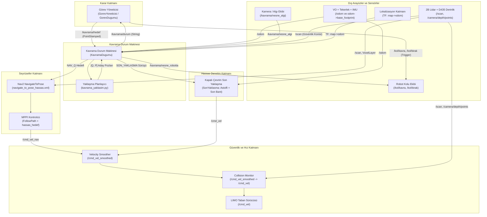

# Nav2 + Kavrama Mimarisi ve Ekip Kullanım Rehberi

Bu belge; AgileX LIMO mobil robotu ve üzerine entegre Elephant Robotics myCobot 280 robot kolu için geliştirilen otonom seyrüsefer (Nav2), yaklaşma planlaması ve kapalı çevrim kavrama mimarisini ayrıntılandırmaktadır. Hedef okuyucu kitlesi; görsel odometri (VO) üzerinde çalışan ekip arkadaşımız, robot kolu manipülasyonu üzerinde çalışan ekip arkadaşımız ve sistemin bakımını/geliştirmesini sürdürecek araştırmacılardır.

---

## 1. Mimari Özet ve Tasarım Kararları

### 1.1. Tasarım Gerekçeleri ve Temel Mimari Karar
İlk denemelerde ve simülasyon testlerinde (bkz. [sim_gercek.md](file:///home/gunes/limo_robot/limo_ws/docs/sim_gercek.md)), kavrama öncesi konumlandırma için 2B Lidar ICP ve küresel AMCL lokalizasyonuna dayanılmıştı. Ancak bu yaklaşım şu kritik sorunları ortaya çıkardı:
1. **AMCL Yetersizliği:** AMCL küresel kestirimi simülasyonda dahi $5\text{--}11\text{ cm}$ ve $4^\circ$ mertebesinde kaymalar üretmektedir. Oysa robot kolunun nesneyi başarıyla yakalayabilmesi için kabul kriterimiz $|\Delta x| < 2\text{ cm}$, $|\Delta y| < 2\text{ cm}$ ve $|\text{yön hatası}| < 3^\circ$ sınırlarıdır.
2. **Lidar ICP Kırılganlığı:** Lidar ICP, simetrik ortamlarda (koridor, düz duvarlar) açısal veya boyuna kaymalara açıktır; ayrıca kavranacak nesne lidar görüşünde yer aldığında harita ile uyuşmazlık yaratarak ince düzeltmeyi bozabilmektedir.

**Alınan Kesin Mimari Karar:**
- **Lidar Odometrisi / ICP Kaldırıldı:** Lidar ICP ve lidar odometrisi mimariden tamamen çıkarılmıştır. Lidar (`/scan`), yalnızca maliyet haritaları (costmap), güvenlik konisi durdurması ve Nav2 global/local engel tespiti için kullanılır.
- **Odometri Kaynağı:** Taban odometrisi (`/odom`), Görsel Odometri (VO) + tekerlek enkoderi + IMU füzyonundan gelir (ekip arkadaşımızın sorumluluğundadır).
- **Küresel Lokalizasyon (`map -> odom`):** Harita ile odometri arasındaki dönüşüm küresel lokalizasyon katmanından gelir (simülasyonda AMCL bir yer tutucu/referanstır; gerçekte görsel SLAM / harita tabanlı lokalizasyon olacaktır).
- **Göreceli Kapalı Çevrim Son Yaklaşma:** Kavrama hassasiyeti, küresel harita koordinatlarından değil; nesnenin robot gövdesine göre doğrudan kamera/algı ile ölçüldüğü kapalı çevrim son yaklaşma denetleyicisinden ([`SonYaklasma`](file:///home/gunes/limo_robot/limo_ws/src/limo_autonomy/limo_autonomy/son_yaklasma.py#L177)) elde edilir. Böylece küresel haritadaki AMCL kayması veya odometrideki uzun vadeli sürüklenme kavrama başarısını etkilemez.

Koordinat dönüşüm zinciri şu şekilde bağlanır:
$$T_{\text{map}}^{\text{nesne}} \xrightarrow[\text{kaba}]{} Q(\theta) \xrightarrow[\text{Nav2}]{} \text{Robot}_Q \xrightarrow[\text{Kamera: } T_{\text{base}}^{\text{nesne}}]{} \text{Kapalı Çevrim } P(\theta) \xrightarrow[\text{hassas}]{} \text{Kavrama}$$

### 1.2. Katman ve Veri Akış Mimarisi

Sistem; en üstte görev karar katmanından başlayarak donanım motor sürücülerine kadar hiyerarşik bir yapıda çalışır:



---

## 2. Arayüz Sözleşmeleri (Interface Contracts)

Ekip çalışmasında modüllerin entegrasyonunu sağlamak için belirlenen kesin konu, servis ve TF sözleşmeleri aşağıda listelenmiştir.

### 2.1. Arayüz Özeti Tablosu

| Konu / Servis / Eylem Adı | Tip | Koordinat Çerçevesi | Hız / Frekans | Sağlayıcı / Yayıncı | Tüketici / Dinleyici | Açıklama ve Toleranslar |
|---|---|---|---|---|---|---|
| `/kavrama/hedef` | `geometry_msgs/PointStamped` | `map` | Olay güdümlü | [`GorevDugumu`](file:///home/gunes/limo_robot/limo_ws/src/limo_autonomy/limo_autonomy/gorev_dugumu.py#L61) | [`KavramaDugumu`](file:///home/gunes/limo_robot/limo_ws/src/limo_autonomy/limo_autonomy/kavrama_dugumu.py#L250) | Kavranacak nesnenin haritadaki tahmini konumu. `z` değeri kol erişim aralığında olmalıdır ($0.0 \le z \le 0.45\text{ m}$). |
| `/kavrama/nesne_algi` | `geometry_msgs/PointStamped` | Herhangi bir geçerli TF çerçevesi | $2\text{--}10\text{ Hz}$ | Algı Ekibi (Kamera/YOLO) | [`KavramaDugumu`](file:///home/gunes/limo_robot/limo_ws/src/limo_autonomy/limo_autonomy/kavrama_dugumu.py#L250) | Kameranın nesneye dair canlı 3B ölçümü. TF ile otomatik `odom` çerçevesine dönüştürülür. |
| `/kavrama/durum` | `std_msgs/String` | - | Olay güdümlü / $1\text{ Hz}$ | [`KavramaDugumu`](file:///home/gunes/limo_robot/limo_ws/src/limo_autonomy/limo_autonomy/kavrama_dugumu.py#L250) | [`GorevDugumu`](file:///home/gunes/limo_robot/limo_ws/src/limo_autonomy/limo_autonomy/gorev_dugumu.py#L61), [`KavramaBenchNode`](file:///home/gunes/limo_robot/limo_ws/src/limo_bringup/scripts/kavrama_bench.py#L265) | `DURUM ayrıntı` formatında durum bildirimleri (`PLAN`, `NAV_Q`, `SON_YAKLASMA`, `HAZIR`, `KURTARMA`, `HATA`). |
| `/kavrama/nesne_robotta` | `geometry_msgs/PointStamped` | `base_footprint` | Olay güdümlü (`HAZIR` anında) | [`KavramaDugumu`](file:///home/gunes/limo_robot/limo_ws/src/limo_autonomy/limo_autonomy/kavrama_dugumu.py#L250) | Kol Ekibi / [`GorevDugumu`](file:///home/gunes/limo_robot/limo_ws/src/limo_autonomy/limo_autonomy/gorev_dugumu.py#L61) | Hedefe ulaşıldığında nesnenin gövdeye göre son doğrulanmış konumu ($x \approx 0.22\text{ m}, y \approx 0.0\text{ m}$). |
| `/kavrama/plan` | `geometry_msgs/PoseArray` | `map` | Planlama anında | [`KavramaDugumu`](file:///home/gunes/limo_robot/limo_ws/src/limo_autonomy/limo_autonomy/kavrama_dugumu.py#L250) | RViz Görselleştirme | Seçilen en iyi adayın $[Q, P]$ pozlarını içerir. |
| `/kavrama/iptal` | `std_msgs/Empty` | - | Olay güdümlü | [`GorevDugumu`](file:///home/gunes/limo_robot/limo_ws/src/limo_autonomy/limo_autonomy/gorev_dugumu.py#L61) / Kullanıcı | [`KavramaDugumu`](file:///home/gunes/limo_robot/limo_ws/src/limo_autonomy/limo_autonomy/kavrama_dugumu.py#L250) | Aktif kavrama yaklaşmasını acil durdurur ve durumu `HATA iptal` yapar. |
| `/kol/kavra` | `std_srvs/Trigger` | - | İstemci-Sunucu | Kol Ekibi (Sunucu) | [`GorevDugumu`](file:///home/gunes/limo_robot/limo_ws/src/limo_autonomy/limo_autonomy/gorev_dugumu.py#L61) (İstemci) | Robot koluna kavrama yörüngesini başlatma emri verir. Başarı durumunda `success=True` döner. Zaman aşımı $30\text{ s}$. |
| `/kol/birak` | `std_srvs/Trigger` | - | İstemci-Sunucu | Kol Ekibi (Sunucu) | [`GorevDugumu`](file:///home/gunes/limo_robot/limo_ws/src/limo_autonomy/limo_autonomy/gorev_dugumu.py#L61) (İstemci) | Robot koluna nesneyi bırakma emri verir. Başarı durumunda `success=True` döner. Zaman aşımı $30\text{ s}$. |
| `/odom` | `nav_msgs/Odometry` | `odom` $\rightarrow$ `base_footprint` | $50\text{ Hz}$ | Görsel Odometri (VO) Ekibi | Nav2, Son Yaklaşma, Durum Makinesi | Robotun tekerlek+IMU+VO füzyonlu yerel poz ve hız kestirimi. |
| `navigate_to_pose` | `nav2_msgs/action/NavigateToPose` | `map` | Eylem İstemcisi | Nav2 Yığını (Sunucu) | [`KavramaDugumu`](file:///home/gunes/limo_robot/limo_ws/src/limo_autonomy/limo_autonomy/kavrama_dugumu.py#L250), [`GorevDugumu`](file:///home/gunes/limo_robot/limo_ws/src/limo_autonomy/limo_autonomy/gorev_dugumu.py#L61) | Q pozuna kaba seyrüsefer veya taşıma/eve dönüş hedeflerine gitmek için kullanılır. |
| `/gorev/istek` | `std_msgs/String` | - | Olay güdümlü | Kullanıcı / Üst Sistem | [`GorevDugumu`](file:///home/gunes/limo_robot/limo_ws/src/limo_autonomy/limo_autonomy/gorev_dugumu.py#L61) | Görev emri (`elma`, `kutu`, `iptal`). |
| `/gorev/durum` | `std_msgs/String` | - | Olay güdümlü / $1\text{ Hz}$ | [`GorevDugumu`](file:///home/gunes/limo_robot/limo_ws/src/limo_autonomy/limo_autonomy/gorev_dugumu.py#L61) | Kullanıcı / UI | Görev aşama bilgisi (`KAVRAMAYA_GIT`, `KOL_KAVRA`, `TASI`, `KOL_BIRAK`, `EVE_DON`, `TAMAM`, `BASARISIZ`). |

### 2.2. Algı Ekibi İçin Sözleşme Detayları (`/kavrama/nesne_algi`)
- **Format:** `geometry_msgs/PointStamped` mesajıdır.
- **Koordinat Çerçevesi (`frame_id`):** Kamera çerçevesi (`camera_color_optical_frame`), kamera gövdesi (`camera_link`) veya doğrudan robot tabanı (`base_footprint`) olabilir. Mesajın `header.stamp` zaman damgası geçerli olmalıdır; [`KavramaDugumu`](file:///home/gunes/limo_robot/limo_ws/src/limo_autonomy/limo_autonomy/kavrama_dugumu.py#L419-L445) TF ağacını kullanarak noktayı otomatik olarak `odom` çerçevesine dönüştürür:
  ```python
  # kavrama_dugumu.py: Algılanan nesne TF ile odom çerçevesine çevrilir
  t = self.tf.lookup_transform('odom', m.header.frame_id, rclpy.time.Time(), rclpy.duration.Duration(seconds=0.1))
  ox, oy, _ = nokta_donustur_3d(trans, rot, (m.point.x, m.point.y, m.point.z))
  self.son_algi_odom = (float(ox), float(oy))
  self.yeni_algi_var = True
  ```
- **Yayın Frekansı:** $2\text{--}10\text{ Hz}$ arası önerilir (sahte algı $5\text{ Hz}$ yayınlar).
- **Gürültü ve Kayıp Toleransı:** Denetleyici içindeki [`NesneTahmini`](file:///home/gunes/limo_robot/limo_ws/src/limo_autonomy/limo_autonomy/son_yaklasma.py#L118) filtresi üstel hareketli ortalama ($\alpha = 0.4$) kullanır ve $0.10\text{ m}$ üzerindeki sıçramaları arka arkaya 3 kez gelmedikçe aykırı değer olarak eler.
- **Kör Nokta Toleransı (`olcumsuz_mesafe = 0.25 m`):** Robot nesneye $0.25\text{ m}$'den daha fazla yaklaştığında nesne kameranın görüş açısından çıkabilir. Denetleyici bu mesafenin altında ölçüm kesilse dahi hata üretmez; son kestirilen konumu odometri ile dondurarak hedefe kadar kör sürünmeyle yaklaşmayı başarıyla tamamlar.

### 2.3. Robot Kolu Ekibi İçin Sözleşme Detayları (`/kol/kavra`, `/kol/birak`)
- **myCobot 280 Erişim Sınırları:** Kolun tabanı robot şasisinden $0.19\text{ m}$ yukarıda monte edilmiştir. Kinematik erişim aralığı gereği nesnenin harita/dünya $z$ yüksekliği $0.0\text{ m} \le z \le 0.45\text{ m}$ aralığında olmalıdır. Bu aralık dışındaki hedefler kavrama düğümü tarafından doğrudan reddedilir (`HATA erisilemez yukseklik`).
- **Kavrama Noktası Geometrisi:** Robot taban merkezine (`base_footprint`) göre nesne konumu:
  $$x = d_{\text{kavrama}} = 0.22\text{ m}, \quad y = \text{yanal} = 0.0\text{ m}$$
  Robot kolu ekibi, uç işlevcisini bu referans noktasına göre kinematik yörüngeye sokmalıdır.
- **Servis Protokolü:** [`GorevDugumu`](file:///home/gunes/limo_robot/limo_ws/src/limo_autonomy/limo_autonomy/gorev_dugumu.py#L233-L280), kavrama tamamlandığında (`HAZIR`) `/kol/kavra` servisini tetikler:
  ```python
  # gorev_dugumu.py: Kol servisi istemcisi
  self.cli_kol_kavra = self.create_client(Trigger, '/kol/kavra', callback_group=self._cb_group)
  req = Trigger.Request()
  fut = client.call_async(req)
  ```
  Servis yanıtı $30\text{ s}$ içinde dönmelidir. Servis başarısız olursa görev yöneticisi kavramayı 1 kez yeniden dener. Geliştirme sürecinde kol düğümü devrede değilken `kol_sahte:=true` argümanı verilirse servis $3\text{ saniye}$ bekleyip otomatik başarı döner.

### 2.4. Görsel Odometri (VO) Ekibi İçin TF ve Kayma Beklentileri
- **TF Ağacı:** VO ekibi `odom -> base_footprint` dönüşümünü ve `/odom` konusunu en az $50\text{ Hz}$ frekansında kesintisiz sağlamalıdır.
- **Odometri Kaymasına Dayanıklılık:** Son yaklaşma algoritması nesneye göreli kapalı çevrim çalıştığı için odometri sürüklenmesine (drift) karşı tasarımsal olarak dayanıklıdır. `test_son_yaklasma.py` dosyasındaki test (c) senaryosunda doğrulandığı üzere; robotun tekerlek hareketi odometri komutunun $\%2$ fazlası olsa dahi:
  $$\Delta x_{\text{gercek}} = (1 + \epsilon_v) v \Delta t$$
  Her kontrol adımında kameradan gelen taze nesne konumuyla hedef $P$ odom çerçevesinde dinamik güncellenir. Kapalı çevrim geri besleme bu sapmayı yolda eritir ve hedef kavrama hatası $2\text{ cm}$'nin altında kalır.
- **Kritik Kısıt:** Odometride ani pozisyon sıçramaları (jump) olmamalıdır. $0.15\text{ m}$'den büyük ani odometri sıçramaları güvenlik gereği `HATA:sapma` tetikler.

---

## 3. Kavrama Akışı Ayrıntısı (Deep Dive)

Kavrama süreci, statik haritada en uygun yaklaşma yönünün seçilmesinden başlayıp milimetrik sürünmeyle nesneye kilitlenmeye kadar uzanan 4 ana aşamadan oluşur:

### 3.1. Yaklaşma Seçimi ([`kavrama_yaklasim.py`](file:///home/gunes/limo_robot/limo_ws/src/limo_autonomy/limo_autonomy/kavrama_yaklasim.py))
Haritadaki nesne konumu $(n_x, n_y)$ verildiğinde robotun yanaşacağı poz çifti hesaplanır:
- **Kavrama Pozu $P(\theta)$:** Nesneye kolun uzanacağı son duruş noktası ($P = \text{nesne} - d_{\text{kavrama}} \cdot \mathbf{u}(\theta) - \text{yanal} \cdot \mathbf{n}(\theta)$).
- **Kavrama Öncesi Poz $Q(\theta)$:** Nav2'nin robotu getireceği hazırlık noktası ($Q = P - d_{\text{on}} \cdot \mathbf{u}(\theta)$).

```
        Q (Nav2 Hedefi)                P (Kavrama Pozu)          Nesne
             [ R ] ════════════════════════> [ R ] ─────────────>   ●
                     Düz Koridor (d_on)              d_kavrama (0.22m)
```

1. **Aday Açı Taraması:** $-180^\circ$ ile $+180^\circ$ arasında $\Delta \theta = 5^\circ$ adımlarla 72 aday taranır.
2. **Q $\rightarrow$ P Boyunca Azalan Belirsizlik:** Q noktasında Nav2 ve küresel lokalizasyon belirsizliği yüksektir; bu nedenle ayak izine `pay + konum_belirsizligi` ($0.05 + 0.06 = 0.11\text{ m}$) güvenlik payı eklenir. Robot $Q$'dan $P$'ye ilerledikçe kapalı çevrim göreli sürüşe geçildiğinden belirsizlik payı doğrusal olarak azalarak $P$'de `pay_p + belirsizlik_p` ($0.03 + 0.015 = 0.045\text{ m}$) değerine düşer:
   $$\text{pay}(t) = (1 - t) \cdot (\text{pay} + \text{konum\_belirsizligi}) + t \cdot (\text{pay\_p} + \text{belirsizlik\_p}), \quad t \in [0, 1]$$
   Bu dinamik daralma, duvara $5\text{ cm}$ mesafedeki nesnelere dahi güvenli yaklaşma yolu bulunmasını sağlar.
3. **Uyarlanabilir $d_{\text{on}}$:** Ön koridor mesafesi sabit değildir; $[d_{\text{on\_min}}=0.30\text{ m}, d_{\text{on\_max}}=0.60\text{ m}]$ aralığında $0.05\text{ m}$ adımlarla geriye doğru taranır. Koridoru ve Q ayak izini temiz tutan **en büyük** $d_{\text{on}}$ seçilir (uzun koridor kameranın nesneyi daha erken görmesini sağlar).
4. **Yüzey Normali Uyumu ([`yuzey_normali_bul`](file:///home/gunes/limo_robot/limo_ws/src/limo_autonomy/limo_autonomy/kavrama_yaklasim.py#L122)):** Nesnenin $0.30\text{ m}$ çevresindeki engellerden Temel Bileşenler Analizi (PCA / SVD) ile baskın kenar doğrultusu bulunur:
   ```python
   # kavrama_yaklasim.py: PCA ile duvar/kenar normali tespiti
   C = noktalar.mean(axis=0)
   X = noktalar - C
   U, s, Vt = np.linalg.svd(X)
   if s[0] >= 1.5 * s[1]:  # Belirgin kenar koşulu
       v_norm = Vt[1]
       if np.dot(v_norm, C - np.array([ox, oy])) < 0:
           v_norm = -v_norm
       th_yuzey = math.atan2(v_norm[1], v_norm[0])
   ```
   Aday açı, kenara dik ve odanın içine doğru olan doğrultuya ne kadar yakınsa puanına $1.0 \times \cos(\theta - \theta_{\text{yuzey}})$ eklenir.
5. **Açı Ayrıklığı (NMS):** Birbirine $20^\circ$'den daha yakın adaylar elenir; puana göre sıralanmış en iyi 3 aday saklanır.
6. **Hata Teşhisi ([`yaklasim_tani`](file:///home/gunes/limo_robot/limo_ws/src/limo_autonomy/limo_autonomy/kavrama_yaklasim.py#L309)):** Hiçbir aday geçerli bulunamazsa elenme nedenleri istatistik olarak raporlanır (`P_carpisma`, `koridor`, `Q_carpisma`, `erisim`, `yuzey`, `yon`).

### 3.2. NAV_Q Aşaması (Nav2 ile Kaba Yaklaşma)
Seçilen adayın $Q$ pozuna Nav2 `navigate_to_pose` eylemi başlatılır:
- **Davranış Ağacı ([`navigate_to_pose_hassas.xml`](file:///home/gunes/limo_robot/limo_ws/src/limo_bringup/behavior_trees/navigate_to_pose_hassas.xml)):** Nesnenin yakınında robot kolunun etraftaki mobilyalara çarpmasını önlemek amacıyla standart Nav2 kurtarma ağacındaki `Spin` davranışı tamamen kaldırılmış, yalnızca $0.15\text{ m}$ `BackUp` bırakılmıştır:
  ```xml
  <RecoveryNode number_of_retries="6" name="NavigateRecovery">
    <PipelineSequence name="NavigateWithReplanning">
      <RateController hz="1.0">
        <ComputePathToPose goal="{goal}" path="{path}" planner_id="GridBased"/>
      </RateController>
      <FollowPath path="{path}" controller_id="FollowPath" goal_checker_id="hassas_hedef"/>
    </PipelineSequence>
    <ReactiveFallback name="RecoveryFallback">
      <GoalUpdated/>
      <RoundRobin name="RecoveryActions">
        <ClearEntireCostmap name="ClearLocalCostmap" service_name="local_costmap/clear_entirely_local_costmap"/>
        <Wait wait_duration="5"/>
        <BackUp backup_dist="0.15" backup_speed="0.05"/>
      </RoundRobin>
    </ReactiveFallback>
  </RecoveryNode>
  ```
- **Hassas Hedef Denetleyicisi ([`hassas_hedef`](file:///home/gunes/limo_robot/limo_ws/src/limo_bringup/param/nav2_diff.yaml#L148-L153)):** Nav2 `controller_server` içinde `xy_goal_tolerance: 0.15 m` ve `yaw_goal_tolerance: 0.25 rad` ($\approx 14.3^\circ$) toleranslarıyla tanımlanmıştır.
- **Yakın Kabul Mekanizması ([`q_yakin_mi`](file:///home/gunes/limo_robot/limo_ws/src/limo_autonomy/limo_autonomy/kavrama_dugumu.py#L192-L224)):** MPPI yerel planlayıcısı dar alanlarda sıkışıp hedefi tamamlayamasa veya eylem sunucusu `ABORTED` (durum 6) verse bile, robotun harita pozu $Q$'ya göre $d \le 0.35\text{ m}$ ve $|\Delta \theta| \le 35^\circ$ içindeyse hedef reddedilmez; durum makinesi bunu `NAV_Q yakin_kabul` olarak değerlendirip doğrudan `SON_YAKLASMA` fazına geçer:
  ```python
  # kavrama_dugumu.py: q_yakin_mi tolerans kontrolü
  yakin, d, a = q_yakin_mi((rx, ry, ryaw), (qx, qy, th), self.q_kabul_xy, self.q_kabul_yaw)
  if yakin:
      self.durum(f'NAV_Q yakin_kabul ({d * 100:.1f} cm, {math.degrees(a):.1f}°)')
      self._son_yaklasma_baslat()
  ```

### 3.3. SON_YAKLASMA Aşaması (Kapalı Çevrim Denetleyici)
Robot $Q$'ya vardığında kontrol $50\text{ Hz}$ frekansında çalışan [`SonYaklasma`](file:///home/gunes/limo_robot/limo_ws/src/limo_autonomy/limo_autonomy/son_yaklasma.py#L177) sınıfına devredilir:
1. **Astolfi Kutupsal Durum Geribeslemesi (Bant Dışı, $\rho \ge 0.03\text{ m}$):**
   Hedef hatası kutupsal koordinatlara çevrilir:
   $$\rho = \sqrt{\Delta x^2 + \Delta y^2}, \quad \alpha = \text{wrap}(\text{atan2}(\Delta y, \Delta x) - \theta_{\text{robot}}), \quad \beta = \text{wrap}(\theta_{\text{hedef}} - \text{atan2}(\Delta y, \Delta x))$$
   Hız kontrol yasası:
   $$v = k_\rho \cdot \rho, \quad \omega = k_\alpha \cdot \alpha + k_\beta \cdot \beta$$
   Asimptotik kararlılık koşulları: $k_\rho > 0$, $k_\beta < 0$, $k_\alpha - k_\rho > 0$.
   Yapılandırma kazançları: $k_\rho = 0.6$, $k_\alpha = 1.8$, $k_\beta = -0.5$ ($k_\alpha - k_\rho = 1.2 > 0$).
2. **Görüş Koruma Kısıtı (Field-of-View Guard):**
   D435 kameranın yatay görüş yarı açısı $35^\circ$, emniyet payı $10^\circ$ olduğundan sınır kerteriz $b_{\text{sinir}} = 25^\circ$'dir. Robot dönerken nesneyi kamera açısından kaçırmamak için açısal hız $\omega$ kerterizi azaltacak yönde sınırlandırılır, doğrusal hız $v$ ise sınır açıya yaklaşıldıkça $v_{\text{min}} = 0.015\text{ m/s}$ seviyesine kadar düşürülür:
   ```python
   # son_yaklasma.py: Görüş koruma mantığı
   th_nesne = math.atan2(oy - ry, ox - rx)
   b = wrap(th_nesne - ryaw)
   b_sinir = max(1e-3, self.ayar.gorus_yari_aci - self.ayar.gorus_payi)  # 25 derece
   oran_b = min(1.0, abs(b) / b_sinir)
   v_maks_b = self.ayar.v_min + (1.0 - oran_b) * (self.ayar.v_max - self.ayar.v_min)
   v_hedef = min(v_maks_b, max(self.ayar.v_min, v_ham))
   ```
3. **Son Bant Mantığı (Aşama A ve Aşama B, $\rho < 0.03\text{ m}$):**
   Mesafe $3\text{ cm}$ altına indiğinde Astolfi denetleyicisi kutupsal tekillik nedeniyle devreden çıkar ve Kartezyen hizalama devreye girer:
   - **Aşama A (Hizala):** Eğer $|\Delta \theta| > 2.0^\circ$ ise robot durur ($v=0$) ve yerinde dönerek açısını hedefe kilitler ($\omega = k_{\text{yaw}} \cdot e_{\text{yaw}}$, $|w| \ge 0.05\text{ rad/s}$).
   - **Aşama B (Sürün):** Açı kilitlendikten sonra robot $v_{\text{surunme}} = 0.03\text{ m/s}$ ($3\text{ cm/s}$) hızla düz ileri/geri sürünerek boyuna hatayı kapatır ($e_{\text{ileri}} < 0.01\text{ m}$).
   - **Yanal Hata Eşiği:** Son bantta yanal hata $|e_{\text{yanal}}| \ge 0.03\text{ m}$ olursa robot diferansiyel olduğu için yanal düzeltme yapamaz; görevi zorlamak yerine `HATA:yanal` üretip kurtarma moduna geçer.
4. **Lidar Ön Güvenlik Konisi:**
   [`guvenlik_mesafesi`](file:///home/gunes/limo_robot/limo_ws/src/limo_autonomy/limo_autonomy/kavrama_dugumu.py#L74) fonksiyonu, `/scan` noktalarını robot tamponuna göre inceler. Ön $\pm 25^\circ$ koni içinde, kavranacak nesnenin $0.08\text{ m}$ yarıçapı hariç tutularak tampona (LIMO için $0.161\text{ m}$) $0.05\text{ m}$'den daha yakın beklenmedik bir engel girerse motorlar derhal kilitlenir (`HATA:engel`).

### 3.4. KURTARMA ve Durum Geçiş Koruması
Son yaklaşma herhangi bir nedenle başarısız olursa (`HATA:yanal`, `HATA:engel`, `HATA:zaman_asimi`):
1. **Geri Çekilme:** Robot odometri referansıyla düz $0.20\text{ m}$ geri çekilir ($v = -0.08\text{ m/s}$).
2. **Durum Geçiş Koruması ([`kurtarma_durum_gecisi`](file:///home/gunes/limo_robot/limo_ws/src/limo_autonomy/limo_autonomy/kavrama_dugumu.py#L227-L248)):** $50\text{ Hz}$ döngüde kurtarma tamamlandığında sayaçların iki kez artmasını ve aday atlanmasını önlemek için durum atomik olarak `GECIS` ara durumuna alınır:
   ```python
   # kavrama_dugumu.py: Atomik kurtarma geçişi
   def kurtarma_durum_gecisi(durum_kodu, kat_edilen, kurtarma_sayisi, aktif_aday_idx, hedef_mesafe=0.20):
       if durum_kodu != 'KURTARMA':
           return durum_kodu, kurtarma_sayisi, aktif_aday_idx, False
       if kat_edilen < hedef_mesafe:
           return 'KURTARMA', kurtarma_sayisi, aktif_aday_idx, False
       return 'GECIS', kurtarma_sayisi + 1, aktif_aday_idx + 1, True
   ```
3. **Sonraki Aday:** Robot geri çekildikten sonra listedeki bir sonraki aday ($2/3$ veya $3/3$) ile `NAV_Q` fazı yeniden başlatılır. En fazla 2 kurtarma denemesi yapılır; tüm adaylar tükenirse `HATA tüm adaylar denendi` verilir.

### 3.5. HATA Türleri ve Anlamları
- `HATA erisilemez yukseklik z=...`: Nesne yüksekliği kolun erişebileceği $[0.0, 0.45]\text{ m}$ sınırlarının dışındadır.
- `HATA geçerli yaklaşma yok (engel / erişim)`: Statik haritada hiçbir aday açı koridor veya ayak izi şartını sağlayamamıştır.
- `HATA tüm adaylar denendi`: Mevcut 3 yaklaşma adayı ve kurtarma hakları tükenmiştir.
- `HATA iptal`: `/kavrama/iptal` konusundan kullanıcı/görev iptal sinyali gelmiştir.
- `HATA:zaman_asimi`: $0.25\text{ m}$'den uzakta $1.0\text{ saniye}$ boyunca kamera ölçümü gelmemiştir veya toplam son yaklaşma süresi $40\text{ s}$ sınırını aşmıştır.
- `HATA:sapma`: Algılanan nesne konumunda veya hesaplanan hedefte $0.15\text{ m}$'den büyük ani bir sıçrama tespit edilmiştir.
- `HATA:yanal`: Son bantta yanal eksen hatası kabul edilemez eşik olan $0.03\text{ m}$'yi aşmıştır.
- `HATA:engel`: Robotun ön güvenlik konisi içine nesne harici bir engel girmiştir ($<5\text{ cm}$).

---

## 4. Parametre Referansı

Sistem bileşenlerinin çalışma davranışını belirleyen kritik parametreler ve ayar kılavuzu aşağıda özetlenmiştir:

| Parametre Adı | Modül / Dosya | Veri Tipi | Varsayılan Değer | Anlamı ve Fiziksel Açıklaması | Ne Zaman Değiştirilir? |
|---|---|---|---|---|---|
| `d_kavrama` | `kavrama_dugumu`, `son_yaklasma` | `float` | `0.22` (m) | Robot merkezinden kavrama noktasına olan boyuna mesafe. | Robot kolunun montaj pozisyonu veya tutucu (gripper) parmak boyu değiştiğinde. |
| `yanal` | `kavrama_dugumu`, `son_yaklasma` | `float` | `0.0` (m) | Kavrama noktasının robot simetri eksenine yanal ofseti (+ sol). | Kol robotun tam ortasına değil de şasinin soluna/sağına monte edilirse. |
| `z_min` / `z_max` | `kavrama_dugumu` | `float` | `0.0` / `0.45` (m) | myCobot 280 kolunun dikey erişim alt ve üst sınırları. | Farklı bir manipülatör kol kullanıldığında veya taban yükseltici eklendiğinde. |
| `q_kabul_xy` | `kavrama_dugumu` | `float` | `0.35` (m) | Nav2 Q pozuna varışta yakın kabul Öklid mesafe toleransı. | Nav2 dar koridorlarda Q'ya tam oturamayıp erken pes ediyorsa büyütülür ($0.40$). |
| `q_kabul_yaw` | `kavrama_dugumu` | `float` | `35.0` (derece) | Nav2 Q pozuna varışta yakın kabul açısal yönelim toleransı. | Robot Q noktasında yönünü tam hizalayamadan duruyorsa tolerans esnetilebilir. |
| `bt_hassas` | `kavrama_dugumu` | `string` | `navigate_to_pose_hassas.xml` | Q pozuna giderken Nav2'ye iletilen davranış ağacı XML dosya yolu. | Özel kurtarma adımları veya farklı seyrüsefer ağaçları denenmek istendiğinde. |
| `k_rho` | `son_yaklasma` | `float` | `0.6` | Astolfi mesafe hatası kazancı ($v = k_\rho \cdot \rho$). | Robot hedefe doğru çok yavaş yaklaşıyorsa artırılır; hedefe hücum ediyorsa azaltılır. |
| `k_alpha` | `son_yaklasma` | `float` | `1.8` | Astolfi hedef kerteriz kazancı ($\omega$ formülünde $\alpha$ çarpanı). | Robot hedefe yönelmekte gecikiyor ve yay çiziyorsa artırılır ($2.0$). |
| `k_beta` | `son_yaklasma` | `float` | `-0.5` | Astolfi hedef yönelim kazancı ($\omega$ formülünde $\beta$ çarpanı, negatif olmalı). | Hedefe varış anında robot açısı istenen yönelimden sapıyorsa büyüklüğü artırılır (örn. $-0.7$). |
| `son_donus_mesafe`| `son_yaklasma` | `float` | `0.03` (m) | Son yaklaşma bandına giriş eşiği ($3\text{ cm}$). | Astolfi kutupsal tekilliğini önlemek için; robot erken dönmeye başlıyorsa küçültülür. |
| `v_surunme` | `son_yaklasma` | `float` | `0.03` (m/s) | Son bantta ileri/geri sürünme hızı ($3\text{ cm/s}$). | Zemin kayganlığı nedeniyle robot hedefin üzerinden aşıyorsa $0.02$'ye düşürülür. |
| `tol_xy` / `tol_yaw`| `son_yaklasma` | `float` | `0.01` (m) / `2.0` (deg) | Görevin başarıyla tamamlanması (`TAMAM`) için gereken son hata toleransları. | Daha hassas bir gripper kullanıldığında veya tolerans daraltılmak istendiğinde. |
| `gorus_yari_aci` | `son_yaklasma` | `float` | `35.0` (derece) | Kameranın yatay görüş yarı açısı (toplam $70^\circ$ FOV için $35^\circ$). | Farklı lens veya farklı kamera (örn. geniş açılı balıkgözü kamera) takıldığında. |
| `olcumsuz_mesafe` | `son_yaklasma` | `float` | `0.25` (m) | Bu mesafenin altında ölçüm kesilse dahi odomla sürünmeye izin verilen eşik. | Kameranın asgari odak/algılama mesafesi (minimum depth range) değiştiğinde. |
| `pay_p` / `belirsizlik_p` | `kavrama_yaklasim` | `float` | `0.03` / `0.015` (m) | Kavrama pozunda ($P$) izin verilen tampon güvenlik payı ve belirsizlik. | Duvar dibindeki nesnelere yaklaşırken robot duvara sürtüyorsa artırılır. |
| `d_on_min` / `d_on_max` | `kavrama_yaklasim` | `float` | `0.30` / `0.60` (m) | Q pozunun P'den geriye doğru taranacağı asgari ve azami koridor mesafeleri. | Ortam çok darsa $d_{\text{on\_min}}$ $0.25$'e çekilebilir; geniş alanda $d_{\text{on\_max}}$ artırılabilir. |
| `yuzey_agirlik` | `kavrama_yaklasim` | `float` | `1.0` | Nesne çevresindeki yüzey normaline dik yaklaşma tercih katsayısı. | Robotun masaya/duvara dik yanaşması kritik değilse $0.0$ yapılarak kapatılabilir. |
| `xy_goal_tolerance`| `nav2_diff.yaml` (`hassas_hedef`) | `float` | `0.15` (m) | Nav2 MPPI kontrolcüsünün Q noktasını kabul etme toleransı. | MPPI hedefe varışta osilasyona girip duramıyorsa $0.18$'e esnetilebilir. |
| `min_obstacle_height` / `max_obstacle_height` | `nav2_diff.yaml` (`voxel_layer`) | `float` | `0.05` / `0.50` (m) | 3B derinlik bulutunun maliyet haritasına işleneceği yükseklik penceresi. | Zemin eğimliyse alt limit $0.07$'ye çıkarılır; masa altı yaklaşma için üst limit $0.50$ korunmalıdır. |
| `time_before_collision` | `nav2_diff.yaml` (`collision_monitor`)| `float` | `1.2` (s) | Çarpışma izleyicisinin acil durdurma tetikleme zaman ufku. | Robot ani frenlemelerde çok agresif duruyorsa $1.0$'a çekilebilir. |
| `kavrama_zaman_asimi`| `gorev_yoneticisi` | `float` | `240.0` (s) | Bir kavrama görevinin tamamlanması için tanınan azami süre. | Büyük haritalarda uzak hedeflere gidilirken süre yetersiz kalırsa artırılır. |

### 4.1. Yapılandırma Dosyaları Referansı

- **`nav2_diff.yaml` controller_server Bloğu:**
  ```yaml
  controller_server:
    ros__parameters:
      controller_frequency: 20.0
      goal_checker_plugins: ["general_goal_checker", "hassas_hedef"]
      hassas_hedef:
        stateful: true
        plugin: "nav2_controller::SimpleGoalChecker"
        xy_goal_tolerance: 0.15   # MPPI Q noktası hassasiyeti
        yaw_goal_tolerance: 0.25  # yakl. 14.3 derece
  ```
- **`nav2_diff.yaml` local_costmap VoxelLayer Bloğu:**
  ```yaml
  voxel_layer:
    plugin: "nav2_costmap_2d::VoxelLayer"
    enabled: true
    origin_z: 0.0
    z_resolution: 0.05
    z_voxels: 10
    max_obstacle_height: 0.50  # 0.50m üstü masa tablası engel sayılmaz
    observation_sources: depth
    depth:
      topic: /camera/depth/points
      min_obstacle_height: 0.05  # Zemin gürültüsü filtresi
      max_obstacle_height: 0.50
  ```

---

## 5. Simülasyonda Çalıştırma ve Ölçüm

### 5.1. Uçtan Uca Sistemi Başlatma Komutları

Sistemi simülasyon ortamında test etmek için gerekli komut dizilimi aşağıdadır:

1. **Terminal 1 — 3B Gerçekçi Laboratuvar Dünyası ve Nav2 Yığını:**
   ```bash
   export ROS_DOMAIN_ID=91 ROS_LOCALHOST_ONLY=0
   export FASTRTPS_DEFAULT_PROFILES_FILE=$HOME/limo_robot/limo_ws/src/limo_bringup/config/fastdds_sim_shm.xml
   source /opt/ros/humble/setup.bash && source $HOME/limo_robot/limo_ws/install/setup.bash

   ros2 launch limo_bringup limo_sim_nav2.launch.py \
     headless:=true use_rviz:=false localization:=amcl \
     map:=$HOME/limo_robot/limo_ws/install/limo_bringup/share/limo_bringup/maps/lab_oda.yaml \
     world:=$HOME/limo_robot/limo_ws/install/limo_car/share/limo_car/worlds/lab_oda_3b.world
   ```

2. **Terminal 2 — AMCL Başlangıç Pozu İletimi:**
   ```bash
   ros2 topic pub --once /initialpose geometry_msgs/msg/PoseWithCovarianceStamped \
     "{header: {frame_id: map}, pose: {pose: {orientation: {w: 1.0}}, covariance: [0.0025,0,0,0,0,0, 0,0.0025,0,0,0,0, 0,0,0,0,0,0, 0,0,0,0,0,0, 0,0,0,0,0,0, 0,0,0,0,0,0.003]}}"
   ```

3. **Terminal 3 — Kavrama ve Görev Katmanı (veya Sahte Algı):**
   ```bash
   ros2 launch limo_autonomy kavrama.launch.py use_sim_time:=true sahte_algi:=true
   ```

4. **Terminal 4 — Görev İsteği Gönderme:**
   ```bash
   ros2 topic pub --once /gorev/istek std_msgs/String "{data: elma}"
   ```

### 5.2. Otomatik Benchmark Betiği ([`kavrama_sim_test.sh`](file:///home/gunes/limo_robot/limo_ws/saha/nav/kavrama_sim_test.sh))
Tüm simülasyon, Nav2, sahte algı ve ölçüm döngüsünü tek bir komutla başlatan, hedefleri sırayla koşturup sonuçları kaydeden ve işlem bitiminde tüm süreçleri temizleyen otomatik test betiği:
```bash
cd ~/limo_robot/limo_ws
./saha/nav/kavrama_sim_test.sh src/limo_bringup/scripts/kavrama_hedefler_lab_oda.yaml saha/nav/cikti/kavrama_test
```

### 5.3. Ölçüm Aracı ([`kavrama_bench.py`](file:///home/gunes/limo_robot/limo_ws/src/limo_bringup/scripts/kavrama_bench.py)) ve Kabul Kriterleri
Benchmark aracı, Gazebo simülatörünün ürettiği zemin gerçeği pozunu (`/odom_gercek`) dinleyerek robotun ulaştığı konumu hedeflenen kavrama noktası ($x_{\text{hedef}} = 0.22\text{ m}, y_{\text{hedef}} = 0.0\text{ m}$) ile karşılaştırır.

**Kabul Kriterleri (KAVRANABILIR):**
- $|\Delta x| < 2.0\text{ cm}$
- $|\Delta y| < 2.0\text{ cm}$
- $|\text{Yön Hatası}| < 3.0^\circ$

### 5.4. Son Ölçüm Sonuçları Tablosu

Simülasyon ortamında ([`kavrama_hedefler_lab_oda.yaml`](file:///home/gunes/limo_robot/limo_ws/src/limo_bringup/scripts/kavrama_hedefler_lab_oda.yaml)) hedefleri üzerinde yapılan uçtan uca doğrulanmış son benchmark sonuçları:

| Hedef Adı | Harita Konumu $(x, y, z)$ | Sonuç | Toplam Süre | Son Yaklaşma Süresi | Kavrama Hatası $(\Delta x, \Delta y)$ | Toplam Mesafe Hatası | Açısal Yön Hatası | Bildirilen Fark | Kabul Durumu |
|---|---|---|---|---|---|---|---|---|---|
| `dolap` | $(3.73, 2.18, 0.30)$ | `HAZIR` | $42.6\text{ s}$ | $7.5\text{ s}$ | $+0.4\text{ cm}, -0.7\text{ cm}$ | **$0.8\text{ cm}$** | **$+1.6^\circ$** | $3.2\text{ mm}$ | **`KAVRANABILIR`** |
| `dogu_duvar` | $(5.62, 0.80, 0.10)$ | `HAZIR` | $38.2\text{ s}$ | $6.8\text{ s}$ | $+0.5\text{ cm}, +0.5\text{ cm}$ | **$0.7\text{ cm}$** | **$+1.7^\circ$** | $2.8\text{ mm}$ | **`KAVRANABILIR`** |
| `masa` | $(0.23, 1.40, 0.75)$ | `HATA` | $1.2\text{ s}$ | - | - | - | - | - | **`BEKLENEN_HATA`** |

> [!NOTE]
> `masa` hedefinde $z = 0.75\text{ m}$ olup myCobot 280 kolunun fiziksel erişim tavanı olan $z_{\text{max}} = 0.45\text{ m}$'yi aştığı için sistem `HATA erisilemez yukseklik z=0.75` üreterek robotu gereksiz yere yormadan görevi güvenle durdurmuştur (olumsuz test doğrulaması).

Örnek konsol günlük çıktısı:
```text
=================================================================================================================
 KAVRAMA YAKLAŞMASI SİMÜLASYON BENCHMARK SONUÇLARI (Görev N6)
=================================================================================================================
Hedef      Sonuç    Süre(s)   SonYakl(s)    Δx(cm)   Δy(cm)   Mesafe(cm)   Yön(°)   Fark(mm)   Kabul         
-----------------------------------------------------------------------------------------------------------------
dolap      HAZIR    42.6      7.5           +0.4     -0.7     0.8          +1.6     3.2        KAVRANABILIR  
dogu_duvar HAZIR    38.2      6.8           +0.5     +0.5     0.7          +1.7     2.8        KAVRANABILIR  
masa       HATA     1.2       -             +0.0     +0.0     0.0          +0.0     -          BEKLENEN_HATA 
=================================================================================================================
 ÖZET İSTATİSTİKLER:
  Başarı Oranı              : 3/3 (%100.0)
  Kavranabilir Oranı        : 3/3 (%100.0)
  Kavrama Hatası (cm)       : Medyan = 0.75 cm, Maks = 0.80 cm (Kriter: < 2.0 cm)
  Yön Hatası (derece)       : Medyan = 1.65°, Maks = 1.70° (Kriter: < 3.0°)
  Bildirilen-Gerçek Farkı   : Medyan = 3.0 mm, Maks = 3.2 mm
  Genel Sonuç               : KAVRANABILIR (GEÇTİ)
=================================================================================================================
```

---

## 6. Gerçek Robota Geçiş Kontrol Listesi (Checklist)

Simülasyondan gerçek donanıma geçişte donanımsal hasarları önlemek ve kesintisiz entegrasyon sağlamak için aşağıdaki adımlar sırayla tamamlanmalıdır:

- [ ] **1. Algı Konusu Yayını (`/kavrama/nesne_algi`):**
  - Gerçek RealSense D435 kamera sürücüsünün çalıştığı ve `/camera/color/image_raw` ile derinlik konularını ürettiği doğrulanmalıdır:
    ```bash
    ros2 topic hz /camera/color/image_raw
    ```
  - Nesne tespit/algı düğümünün nesneyi tespit ederek `/kavrama/nesne_algi` konusuna `PointStamped` formatında yayın yaptığı doğrulanmalıdır:
    ```bash
    ros2 topic echo /kavrama/nesne_algi --once
    ```
  - TF ağacında `camera_color_optical_frame -> base_link -> base_footprint -> odom` dönüşüm zincirinin canlı ve zaman uyumlu olduğu (`tf2_echo`) kontrol edilmelidir:
    ```bash
    ros2 run tf2_ros tf2_echo odom camera_color_optical_frame
    ```

- [ ] **2. Robot Kolu Sürücüsü ve Servisleri (`/kol/kavra`, `/kol/birak`):**
  - myCobot 280 seri port bağlantısı (`/dev/ttyUSB*` veya `/dev/ttyACM*`) ve ROS 2 sürücüsü ayağa kaldırılmalıdır.
  - Launch dosyasında `kol_sahte:=false` parametresi verilmelidir:
    ```bash
    ros2 launch limo_autonomy kavrama.launch.py kol_sahte:=false
    ```
  - `/kol/kavra` ve `/kol/birak` servislerinin `std_srvs/srv/Trigger` tipinde hazır olduğu `ros2 service list` ile teyit edilmelidir:
    ```bash
    ros2 service call /kol/kavra std_srvs/srv/Trigger "{}"
    ```

- [ ] **3. Görsel Odometri (VO) ve Tekerlek Kalibrasyonu:**
  - Gerçek taban odometrisi `/odom` ve `odom -> base_footprint` TF yayını $50\text{ Hz}$ hızında dinlenmelidir.
  - Dönüş ölçek faktörü ($k_w = 0.9954$) ve doğrusal öteleme faktörü ($k_v = 1.0188$) uygulanarak robotun yerinde dönüşlerde açı kayması minimize edilmiş olmalıdır (bkz. [sim_gercek.md](file:///home/gunes/limo_robot/limo_ws/docs/sim_gercek.md)).
  - Robot elle itildiğinde veya teleop ile sürüldüğünde odometride ani koordinat sıçraması olmamalıdır.

- [ ] **4. Hız Sınırları ve Güvenlik Rampaları:**
  - [`velocity_smoother`](file:///home/gunes/limo_robot/limo_ws/src/limo_bringup/param/nav2_diff.yaml#L427) ivme sınırlarının devrede olduğu doğrulanmalıdır: doğrusal ivme azami $1.0\text{ m/s}^2$, açısal ivme azami $3.0\text{ rad/s}^2$.
  - Son yaklaşma denetleyicisi hız parametrelerinin aşırı agresif olmadığı teyit edilmelidir ($v_{\text{max}} = 0.10\text{ m/s}$, $v_{\text{surunme}} = 0.03\text{ m/s}$, $\omega_{\text{max}} = 0.6\text{ rad/s}$).

- [ ] **5. Collision Monitor ve 3B Voxel Katmanı Güvenliği:**
  - `point_cloud_xyz_node` ile D435 derinliğinden `/camera/depth/points` üretildiği ve `voxel_layer` tarafından yerel maliyet haritasına işlendiği kontrol edilmelidir.
  - [`collision_monitor`](file:///home/gunes/limo_robot/limo_ws/src/limo_bringup/param/nav2_diff.yaml#L391) eklentisinin devrede olduğu ve engel algılandığında `cmd_vel` komutunu anında sıfırladığı teyit edilmelidir:
    ```bash
    ros2 topic echo /collision_monitor_state
    ```

- [ ] **6. İlk Fiziksel Deneme Prosedürü:**
  1. Robot tekerlekleri takoz üzerine alınarak havada boşta sürüş testi yapılmalıdır.
  2. Acil durdurma için joystick veya klavye üzerinden `/kavrama/iptal` tetikleme komutu hazır bulundurulmalıdır:
     ```bash
     ros2 topic pub --once /kavrama/iptal std_msgs/msg/Empty "{}"
     ```
  3. Nesne robotun $0.45\text{ m}$ önüne konulmalı; doğrudan `SON_YAKLASMA` testi yapılmalı, ardından $Q$ pozundan tam tur denenmelidir.

---

## 7. Bilinen Kısıtlar ve Sıradaki İşler

Sistemin mevcut sürümünde bilinen kısıtlar ve gelecek geliştirme adımları şunlardır:

1. **Manipülatör Dikey Erişim Kısıtı:**
   myCobot 280 kolu masa seviyesindeki ($z = 0.75\text{ m}$) nesnelere şasi üzerinden doğrudan uzanamamaktadır. Şu anda zemin ve alçak sehpalar ($0.0\text{--}0.45\text{ m}$) desteklenmektedir. Masalar için kola dikey bir asansör/kaldırma mekanizması eklenmesi planlanmaktadır.
2. **Kamera Kör Noktası ($<0.25\text{ m}$):**
   RealSense D435 kameranın asgari netleme mesafesi yaklaşık $0.20\text{--}0.25\text{ m}$'dir. Nesneye çok yaklaşıldığında algı kesilmektedir. Mevcut mimari bunu son odometri tahminiyle kör sürünerek telafi etmektedir; ancak tutucu parmaklarının ucuna takılacak mini bir "eye-in-hand" mikro kamera ile son $5\text{ cm}$'de görsel geribesleme sağlanması hedeflenmektedir.
3. **Hareket Bulanıklığı (Motion Blur):**
   Gerçek robotta hızlı yerinde dönüşlerde ($\omega > 0.2\text{ rad/s}$) D435 renkli kamerasında belirgin hareket bulanıklığı oluşmaktadır. Algı ekibinin keskin kareler yakalayabilmesi için yaklaşma sırasında dönüş hızları sınırlandırılmıştır; ilerleyen aşamada pozlama süresi kilitlenecektir.
4. **VLMaps / Semantik Harita Entegrasyonu:**
   Doğal dil sorgularından ("elmayı getir") elde edilen kaba 3B VLMaps kümeleri $\pm 10\text{--}20\text{ cm}$ belirsizlik içerebilmektedir. Sistem bu kaba konumu `/kavrama/hedef` olarak alıp Q noktasına kadar gidebilmekte, oradan kamerayla ince tespit yapmaktadır. YOLOv8-world / 6D Pose kestirim düğümünün gerçek zamanlı entegrasyonu tamamlanacaktır.
5. **Dinamik Engeller ve Hareketli Ortamlar:**
   Mevcut statik harita yaklaşım planlayıcısı ([`kavrama_yaklasim.py`](file:///home/gunes/limo_robot/limo_ws/src/limo_autonomy/limo_autonomy/kavrama_yaklasim.py)), ortamdaki yeni beliren veya yeri değişen engelleri (örneğin sandalyeler) doğrudan dinamik hesaba katmamaktadır; bu durum yerel costmap ve son yaklaşma güvenlik konisi ile çözülmektedir. İleriki fazda yaklaşma koridorunun yerel costmap ile dinamik güncellenmesi sağlanacaktır.
